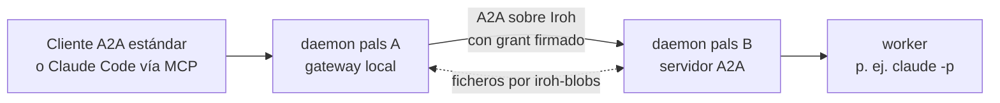

# PALS — Peer Agent Linking System

Red entre pares para que agentes de IA se encuentren, se autoricen y trabajen juntos sin depender de un directorio central. Cada agente ejecuta un daemon, `pals`, que lo conecta con otros agentes, controla qué pueden pedirle y le entrega el trabajo autorizado. Los mensajes, las tareas, sus estados, el streaming y la cancelación son [A2A](https://a2a-protocol.org/) v1.0: un cliente A2A estándar llega a cualquier par por el gateway local con los bindings JSON-RPC y HTTP+JSON, y entre pares esos mismos bindings viajan dentro del binding propio `http-over-iroh/v1`. Los bytes de los ficheros van aparte, por iroh-blobs, fuera de A2A; los mensajes A2A los nombran con una URL.

> **Estado:** hito 1 implementado. La conformidad con A2A, con el alcance exacto que fija el [informe](docs/conformance/hito-1/README.md#lo-que-queda-respaldado), está respaldada por el kit de conformidad oficial (TCK) y el SDK oficial de Python. La **prueba de salida en dos máquinas está pendiente**: de momento solo hay un [ensayo en una máquina](docs/conformance/hito-1/exit-test.md). Es un prototipo; lee las [limitaciones](#limitaciones-conocidas-del-hito-1) antes de usarlo.

El documento de diseño llama al protocolo «Agentnet»; por eso los identificadores que viajan por la red conservan el prefijo `agentnet` (`agentnet.grant/1`, `agentnet-a2a-http/1`, `x-agentnet-peer`). El producto, el binario y los crates se llaman `pals`.

## Qué hace el hito 1

- **Identidad.** Una clave Ed25519 por agente, que es también la de su endpoint de [Iroh](https://www.iroh.computer/). El id del agente es esa clave pública en 64 caracteres hexadecimales.
- **Conexión.** Los daemons se hablan por QUIC con Iroh, en directo o a través de un relay.
- **Autorización.** *Grants* firmados (JSON canónico JCS y Ed25519) que dicen quién puede pedir qué, en qué proyecto y hasta cuándo. Se pueden revocar. Toleran 60 s de diferencia entre relojes.
- **A2A v1.0.** Cada daemon es un servidor A2A completo, hecho con el SDK oficial de Rust, con los bindings JSON-RPC y HTTP+JSON y streaming por SSE. Entre pares, esas mismas peticiones HTTP viajan dentro de streams de Iroh.
- **Gateway local.** Cualquier cliente A2A estándar llega a cualquier par en `http://127.0.0.1:7420/peers/<par>/…`; el gateway añade el grant y hace de túnel.
- **Ficheros.** Viajan aparte, con iroh-blobs y fuera de A2A, verificados con BLAKE3; en los mensajes A2A son partes con URL. Quien tiene el fichero decide quién lo descarga: conocer el hash no da acceso.
- **Worker.** El trabajo que llega lo hace un adaptador: `echo`, `exec` (cualquier orden, como `claude -p`, en el directorio del proyecto) o `tck` (solo para las pruebas de conformidad).
- **Preguntas fiables.** `pals ask` guarda cada pregunta antes de enviarla, reintenta y se vuelve a suscribir sin ejecutar el trabajo dos veces.
- **MCP.** Un servidor MCP local con seis herramientas, para que una aplicación de IA como Claude Code trabaje con los pares.
- **Almacén local.** SQLite con las tareas, los contactos, los grants, las revocaciones, la deduplicación y un registro de eventos firmado y encadenado por hashes.



## Instalación

Rust 1.91 o posterior (edición 2024):

```bash
cargo install --locked --path crates/pals
pals --help
```

## Arranque rápido

Dos agentes, A y B, cada uno en su máquina. En cada una:

```bash
pals init            # crea ~/.pals/config.toml y la clave del agente
pals daemon          # en otra terminal: atiende a los pares y abre el gateway local
pals id --ticket     # con el daemon en marcha: el ticket que el otro agente guarda
```

Se guardan como contactos y B da permiso a A:

```bash
# En A
pals contact add '<ticket de B>' --name b
# En B
pals contact add '<ticket de A>' --name a
pals grant issue --to a --project demo --ttl 24h     # imprime el token del grant
# En A
pals grant import '<token>'
pals ask b "¿Qué tal?"
```

Con la configuración por defecto, B responde con el adaptador `echo`. Para que responda Claude Code sobre un proyecto, sustituye la sección `[worker]` del `~/.pals/config.toml` de B por la de abajo (no la añadas al final: una segunda `[worker]` es un error de TOML) y añade el proyecto:

```toml
[worker]
adapter = "exec"
command = "claude"
args = ["-p", "--output-format", "text"]

[projects.demo]       # el proyecto del grant
path = "/ruta/al/proyecto"
```

La orden corre en el directorio del proyecto del grant, recibe la pregunta por stdin y responde por stdout, que llega tal cual al par que preguntó; si falla, ese par recibe además los últimos 4 KiB de su stderr como motivo. Los ficheros adjuntos están en `$PALS_IN_DIR`, y los que deje en `$PALS_OUT_DIR` (32 como mucho) vuelven como ficheros de la respuesta. `pals init` escribe el fichero con todas las opciones y su explicación.

Más órdenes:

| Orden | Qué hace |
|-|-|
| `pals ask <par> "<pregunta>" [--attach FICHERO]… [--wait 600s]` | Pregunta y espera la respuesta. Escribe en stderr el `messageId` en cuanto guarda la pregunta, para retomarla si la orden se interrumpe. Sale con `0` si la tarea se completa, `2` si falla, se rechaza o se cancela, y `3` si el par no responde o la espera se agota; en ese caso la pregunta queda guardada |
| `pals task ls` · `pals task resume <messageId>` · `pals task cancel <messageId>` | Las preguntas hechas; retomar una sin ejecutarla dos veces; cancelar su tarea |
| `pals contact ls` | Los pares guardados |
| `pals grant ls [--issued \| --held]` · `pals grant revoke <grant_id>` | Grants emitidos y recibidos; revocar uno emitido |
| `pals id` | El id del agente |

Todo vive en `~/.pals`, o en el directorio de `$PALS_HOME` o `--home`: `config.toml`, la clave (`agent.key`), el almacén (`pals.db`), los blobs y los directorios de trabajo de las tareas. Para dos agentes en la misma máquina, usa dos directorios con gateways en puertos distintos.

Entre dos máquinas hace falta `net.relay = true`, el valor por defecto. El procedimiento completo para probarlo, caso por caso, está en el [runbook de la prueba en dos máquinas](docs/runbooks/hito-1-dos-maquinas.md).

## Conectar un cliente MCP

El servidor MCP está en el gateway, en `http://127.0.0.1:7420/mcp` (Streamable HTTP). Con Claude Code:

```bash
claude mcp add --transport http pals http://127.0.0.1:7420/mcp
```

| Herramienta | Qué hace |
|-|-|
| `pals_whoami` | Id, nombre y ticket de este agente |
| `pals_contacts` | Los pares guardados, y si se tiene un grant para cada uno |
| `pals_ask` | Pregunta a un par, con ficheros si hace falta, y espera `wait_s` segundos: 50 por defecto, 3600 como mucho |
| `pals_task` | Retoma una pregunta por su `message_id` sin ejecutarla dos veces |
| `pals_cancel` | Cancela la tarea de una pregunta |
| `pals_fetch` | Descarga un fichero de una respuesta a un fichero nuevo del directorio de descargas |

`pals_ask` espera 50 s por defecto, menos que el tiempo máximo de una llamada en los clientes MCP habituales, y la espera cuenta la subida de los adjuntos; si la respuesta tarda más, devuelve el `message_id` y la IA sigue con `pals_task`. Una llamada que el cliente cancela antes de que la pregunta quede guardada no pregunta nada. La CLI espera 600 s.

`pals_fetch` solo escribe dentro del directorio de descargas, `[mcp] download_dir` en `config.toml` (`~/Downloads/pals` por defecto, creado con permisos `0700` la primera vez y nunca dentro del directorio de datos): un nombre de fichero, una ruta relativa dentro de él o una ruta absoluta que, resuelta, quede dentro; ninguna parte puede empezar por punto, y nunca sobrescribe. Las instrucciones del servidor MCP le dicen a la IA qué directorio es.

## Clientes A2A estándar

Un cliente A2A cualquiera habla con el par `<par>` (nombre de contacto o id) a través del gateway del daemon local:

| Recurso | URL |
|-|-|
| Agent Card | `http://127.0.0.1:7420/peers/<par>/.well-known/agent-card.json` |
| JSON-RPC | `http://127.0.0.1:7420/peers/<par>/jsonrpc` |
| HTTP+JSON | `http://127.0.0.1:7420/peers/<par>/rest` |
| Ficheros | `GET http://127.0.0.1:7420/blobs/<poseedor>/<hash>` para descargar; `POST http://127.0.0.1:7420/blobs` para subir |

El gateway añade el grant más reciente que tenga para ese par. Cada petición A2A lleva `A2A-Version: 1.0`, como cabecera o como parámetro de la petición.

El gateway nunca reenvía tal cual lo que responde un par. Si el cliente espera un documento JSON o un stream SSE lo decide su propia petición (el método JSON-RPC o la ruta HTTP+JSON), nunca el `Content-Type` del par. Lee la respuesta con un límite de 16 MiB por cuerpo, o por evento SSE antes de que termine; una respuesta correcta (`2xx`) y los datos de cada evento tienen que ser JSON, sin identificadores de tarea inseguros: ni en `taskId`/`task_id`, ni en `referenceTaskIds`/`reference_task_ids`, ni como `id` de ningún objeto (salvo el sobre JSON-RPC y lo que hay dentro de `metadata`, `data` y `details`), porque un id como `../../../<otro par>/rest/tasks/x` llevaría al cliente, al normalizar la URL, hasta otro par con el grant que el gateway tiene para él. Lo que pasa al cliente es la codificación del propio gateway de lo que comprobó: JSON solo en ASCII, y cada evento como `data: <JSON>` (sin los campos `event:` ni `id:` ni los comentarios del par; un evento sin datos llega como `:`). Una respuesta rechazada llega como `502 {"error":"peer protocol error"}`; un stream rechazado se corta antes del evento culpable. Un par PALS nunca envía nada de eso. Al recodificar, un número JSON que no cabe exacto en un entero de 64 bits ni en un `f64` pierde precisión.

`ListTasks` devuelve las tareas de la actualizada más recientemente a la más antigua, pagina con un cursor opaco y omite los artefactos salvo con `includeArtifacts: true` (A2A §3.1.4); el SDK de Rust fijado no lo hace, y PALS lo corrige en su almacén.

## Compatibilidad con A2A

Lo que queda respaldado, tal como lo establece el [informe de conformidad](docs/conformance/hito-1/README.md):

> **A2A v1.0 con los bindings JSON-RPC y HTTP+JSON a través del gateway local; entre pares, el binding propio `http-over-iroh/v1` (`…/v1/jsonrpc` y `…/v1/http-json`), que transporta esos mismos bindings.**

El TCK oficial (`a2aproject/a2a-tck` en `104a7b4ae0d8`), ejecutado a través del gateway, no deja ningún requisito MUST automatizado fallido en `jsonrpc` ni en `http_json` (72 superados; los saltados lo son por capacidades que PALS no declara o por ser de gRPC), y el SDK oficial de Python completa sus 4 comprobaciones por los dos bindings. Queda pendiente un requisito `MANUAL` de nivel MUST, `AUTH-TLS-001`, que necesita la aceptación expresa del responsable. No quedan respaldados los 16 requisitos MUST sin prueba automática en el TCK, los `MANUAL` ni el SHOULD `HTTP_JSON-SVC-001`. Los detalles, y los rodeos de defectos del SDK de Rust fijado, están en el informe.

Entre pares, la Agent Card declara dos interfaces, una por binding interior, especificadas en [`docs/bindings/http-over-iroh-v1.md`](docs/bindings/http-over-iroh-v1.md):

| Binding interior | URI del binding | URL de la interfaz |
|-|-|-|
| JSON-RPC | `https://github.com/rosepetal-ai/rosepetal-pals/bindings/http-over-iroh/v1/jsonrpc` | `iroh://<agent_id>/jsonrpc` |
| HTTP+JSON | `https://github.com/rosepetal-ai/rosepetal-pals/bindings/http-over-iroh/v1/http-json` | `iroh://<agent_id>/rest` |

Las dos usan el ALPN de Iroh `agentnet-a2a-http/1`. El gateway local presenta a los clientes estándar las mismas dos interfaces como `JSONRPC` y `HTTP+JSON` con URL `http://`.

La idempotencia por `messageId` es una extensión A2A opcional, [`idempotency/v1`](docs/extensions/idempotency-v1.md), que el cliente de PALS activa siempre.

## Limitaciones conocidas del hito 1

- **Sin autenticación local.** Cualquier usuario del sistema operativo de la máquina puede llegar al gateway y al MCP de loopback y actuar con los grants de este agente y con su acceso a ficheros: preguntar a sus pares en su nombre, descargar los blobs de su almacén, adjuntar a través del MCP cualquier fichero regular que el usuario del daemon pueda leer (salvo los de su directorio de datos y los de `/proc`, `/sys`, `/dev` o de un sistema de ficheros procfs o sysfs) y escribir con `pals_fetch` ficheros nuevos dentro del directorio de descargas. El gateway solo rechaza las peticiones de navegadores y los `Host` que no son de loopback.
- **Las órdenes del worker corren como el usuario del daemon** y pueden leer su directorio de datos, incluidas la clave del agente (`agent.key`) y la base de datos (`pals.db`). Una orden como `claude -p`, que actúa según lo que pregunta un par, podría leerlas.
- **El par que pregunta recibe la salida de la orden.** Su stdout es la respuesta y, si la orden falla, los últimos 4 KiB de su stderr van en el motivo del fallo: lo que la orden escriba en cualquiera de los dos (rutas, trazas, secretos) llega al par.
- **Los blobs no caducan.** Los ficheros subidos al gateway y los que un agente envía en sus respuestas se guardan en su almacén sin política de retención; el espacio en disco solo crece.
- **`AUTH-TLS-001` pendiente.** El gateway local habla HTTP sin TLS en loopback; entre pares, el tráfico va cifrado con TLS 1.3 de QUIC. Falta la aceptación expresa del responsable.
- **Esperas distintas en MCP y en la CLI.** `pals_ask` y `pals_task` esperan 50 s por defecto (`wait_s`, como mucho 3600); `pals ask` y `pals task resume`, 600 s (`--wait`).
- **La idempotencia es una extensión opcional.** Un cliente A2A estándar que reintenta con el mismo `messageId` sin activar `idempotency/v1` puede ejecutar el trabajo dos veces, igual que con el SDK de referencia. El cliente de PALS la activa siempre.
- **`A2A-Version` es obligatorio en los dos bindings**, como cabecera o como parámetro de la petición. Sin él la petición cuenta como versión `0.3` y se rechaza con `VersionNotSupportedError`.
- **Madurez de iroh-blobs.** iroh-blobs 0.105.0 indica en su README que todavía no se considera calidad de producción. Se usa porque la versión recomendada para producción, la 0.35, no es compatible con iroh 1.x.
- **El worker limpia el entorno.** Las órdenes solo heredan `PATH`, `HOME` y `LANG` (más las variables `PALS_*` de la tarea), así que `ANTHROPIC_API_KEY` no llega: `claude -p` necesita sus credenciales bajo `HOME` o un guion envoltorio que exporte la clave.
- **Dos máquinas necesitan `net.relay = true`.** Con `relay = false` el daemon se enlaza solo a `127.0.0.1`, y su puerto cambia en cada arranque: los tickets que guardaron sus pares dejan de valer.
- **Un daemon terminado con `SIGKILL` puede dejar vivas las órdenes que corría**, con su grupo de procesos. Al rearrancar, sus tareas quedan `TASK_STATE_FAILED` (`interrupted: daemon restarted`), pero las órdenes hay que terminarlas a mano. Un proceso que una orden saque de su grupo (con `setsid`) escapa además del tiempo máximo y de la cancelación.
- **Un grant por par.** Con varios grants de un mismo par, el gateway usa el más reciente: no se elige el proyecto pregunta a pregunta.
- **Registro mínimo.** El daemon escribe en stderr el arranque, la parada, las preguntas pendientes y sus diagnósticos desde el nivel `INFO` (`RUST_LOG` lo cambia, p. ej. `RUST_LOG=pals=debug`); no informa del camino de red (directo o relay).

Fuera del hito 1: la card firmada (JWS), las notificaciones *push*, el binding gRPC, el acceso directo por HTTPS de clientes sin daemon PALS, el inventario de servicios y el descubrimiento de pares desconocidos.

## Hoja de ruta

| Hito | Contenido | Estado |
|-|-|-|
| 1. Flujo básico | Dos daemons, identidad, grants, `ask`, MCP y worker, ficheros, intercambio A2A estándar | Implementado; prueba de salida en dos máquinas pendiente |
| 2. Consulta de servicios e inventario | Agent Cards firmadas, inventario filtrado por permisos, consultas `ServiceQuery` y ofertas `ServiceOffer` | Planificado |
| 3. Descubrimiento | Encontrar proveedores sin contacto previo con Kademlia, tras comparar alternativas | Planificado |
| 4. Colaboración privada | Catálogos privados sincronizados con P2panda | Solo si aparece un caso real |

## Documentación

- [`docs/plans/initial.md`](docs/plans/initial.md): diseño de la red, revisión 3.
- [`docs/superpowers/plans/2026-11-14-hito-1-flujo-basico-a2a.md`](docs/superpowers/plans/2026-11-14-hito-1-flujo-basico-a2a.md): plan paso a paso del hito 1, con los cambios que impone el requisito de compatibilidad con A2A.
- [`docs/superpowers/plans/2026-11-14-hoja-de-ruta-hitos-2-4.md`](docs/superpowers/plans/2026-11-14-hoja-de-ruta-hitos-2-4.md): hoja de ruta de los hitos 2 a 4.
- [`docs/bindings/http-over-iroh-v1.md`](docs/bindings/http-over-iroh-v1.md): los bindings entre pares.
- [`docs/extensions/idempotency-v1.md`](docs/extensions/idempotency-v1.md): la extensión de idempotencia.
- [`docs/conformance/hito-1/README.md`](docs/conformance/hito-1/README.md): la conformidad con A2A (TCK y SDK de Python) y [`sdk-issues.md`](docs/conformance/hito-1/sdk-issues.md), los defectos del SDK de Rust.
- [`docs/runbooks/hito-1-dos-maquinas.md`](docs/runbooks/hito-1-dos-maquinas.md) y [`docs/conformance/hito-1/exit-test.md`](docs/conformance/hito-1/exit-test.md): la prueba de salida en dos máquinas y el ensayo en una.

## Tecnología

Rust (edición 2024, versión mínima 1.91), tokio, iroh 1.4.1, iroh-blobs 0.105.0, el SDK oficial de A2A para Rust ([`a2aproject/a2a-rs`](https://github.com/a2aproject/a2a-rs): `a2a-lf` 0.4.2, `a2a-server-lf` 0.5.3, `a2a-client-lf` 0.2.9), axum y hyper, rmcp 3.10.0 para MCP y SQLite embebido (rusqlite 0.42). Las versiones están fijadas con `=` en `Cargo.toml` y en `Cargo.lock`; subir cualquiera es un cambio explícito que obliga a repetir las pruebas de conformidad.

## Contribuir

La rama por defecto es `dev` y las pull requests van contra `dev`. La documentación se escribe en español; el código, los identificadores y los comentarios, en inglés. Antes de cada commit:

```bash
cargo fmt --check
cargo clippy --workspace --all-targets -- -D warnings
cargo test --workspace --locked
```

La conformidad se repite con `tests/interop/run_tck.sh` y `tests/interop/python_client.py` (ver el [informe](docs/conformance/hito-1/README.md#ejecución)). Las pautas para agentes de programación están en [`CLAUDE.md`](CLAUDE.md).
