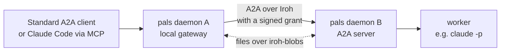

# PALS — Peer Agent Linking System

A peer-to-peer network where AI agents find each other, authorize each other and work together without depending on a central directory. Each agent runs a daemon, `pals`, which connects it to other agents, controls what they may ask of it and hands it the authorized work. Messages, tasks, their states, streaming and cancellation are [A2A](https://a2a-protocol.org/) v1.0: a standard A2A client reaches any peer through the local gateway with the JSON-RPC and HTTP+JSON bindings, and between peers those same bindings travel inside PALS's own binding, `http-over-iroh/v1`. File bytes travel separately, over iroh-blobs, outside A2A; A2A messages name them with a URL.

> **Status.** PALS is a prototype; read the [known limitations](#known-limitations-of-milestone-1) before using it. Milestones are called *hitos* in the Spanish documentation.
>
> - **Works today: milestone 1 (hito 1).** Implemented and reviewed. A2A conformance, with the exact scope set by the [conformance report](docs/conformance/hito-1/README.md#lo-que-queda-respaldado), is backed by the official conformance kit (TCK) and the official Python SDK. The [exit test](docs/conformance/hito-1/exit-test.md) passed all eight cases with a Docker container playing the second machine, with real network cuts and the public relays, but on a single physical host.
> - **In progress: milestone 2 (hito 2), service queries and inventory.** The first of its 13 tasks, JWS signing and verification of Agent Cards in `pals-core`, is implemented and in review, but not yet wired into the daemon. The daemon serves nothing new yet.
> - **Pending the project owner:** accepting `AUTH-TLS-001`, deciding whether the Docker run is enough or the exit test is repeated on two physical machines, and merging milestone 1 into `dev`.

The design document calls the protocol "Agentnet"; that is why the identifiers that travel over the network keep the `agentnet` prefix (`agentnet.grant/1`, `agentnet-a2a-http/1`, `x-agentnet-peer`). The product, the binary and the crates are called `pals`.

## What milestone 1 does

- **Identity.** One Ed25519 key per agent, which is also the key of its [Iroh](https://www.iroh.computer/) endpoint. The agent id is that public key as 64 hexadecimal characters.
- **Connection.** Daemons talk over QUIC with Iroh, directly or through a relay.
- **Authorization.** Signed *grants* (canonical JSON, JCS, and Ed25519) that say who may ask for what, in which project and until when. They can be revoked. They tolerate 60 s of difference between clocks.
- **A2A v1.0.** Each daemon is a full A2A server, built with the official Rust SDK, with the JSON-RPC and HTTP+JSON bindings and streaming over SSE. Between peers, those same HTTP requests travel inside Iroh streams.
- **Local gateway.** Any standard A2A client reaches any peer at `http://127.0.0.1:7420/peers/<peer>/…`; the gateway adds the grant and tunnels the request.
- **Files.** They travel separately, with iroh-blobs and outside A2A, verified with BLAKE3; in A2A messages they are parts with a URL. Whoever holds a file decides who downloads it: knowing the hash gives no access.
- **Worker.** Incoming work is done by an adapter: `echo`, `exec` (any command, such as `claude -p`, in the project directory) or `tck` (only for the conformance tests).
- **Reliable questions.** `pals ask` stores each question before sending it, retries and resubscribes without running the work twice.
- **MCP.** A local MCP server with six tools, so that an AI application such as Claude Code can work with peers.
- **Local store.** SQLite with tasks, contacts, grants, revocations, deduplication and a signed, hash-chained event log.



## Installation

Rust 1.91 or later (edition 2024):

```bash
cargo install --locked --path crates/pals
pals --help
```

## Quick start

Two agents, A and B, each on its own machine. On each one:

```bash
pals init            # creates ~/.pals/config.toml and the agent key
pals daemon          # in another terminal: serves peers and opens the local gateway
pals id --ticket     # with the daemon running: the ticket the other agent saves
```

They save each other as contacts, and B gives A permission:

```bash
# On A
pals contact add '<ticket of B>' --name b
# On B
pals contact add '<ticket of A>' --name a
pals grant issue --to a --project demo --ttl 24h     # prints the grant token
# On A
pals grant import '<token>'
pals ask b "How are you?"
```

With the default configuration, B answers with the `echo` adapter. To have Claude Code answer about a project, replace the `[worker]` section of B's `~/.pals/config.toml` with the one below (do not append it: a second `[worker]` is a TOML error) and add the project:

```toml
[worker]
adapter = "exec"
command = "claude"
args = ["-p", "--output-format", "text"]

[projects.demo]       # the grant's project
path = "/path/to/project"
```

The command runs in the directory of the grant's project, receives the question on stdin and answers on stdout, which reaches the asking peer as is; if it fails, that peer also receives the last 4 KiB of its stderr as the reason. Attached files are in `$PALS_IN_DIR`, and the files it leaves in `$PALS_OUT_DIR` (32 at most) come back as files of the answer. `pals init` writes the file with every option and its explanation.

More commands:

| Command | What it does |
|-|-|
| `pals ask <peer> "<question>" [--attach FILE]… [--wait 600s]` | Asks and waits for the answer. Writes the `messageId` to stderr as soon as it stores the question, so it can be resumed if the command is interrupted. Exits with `0` if the task completes, `2` if it fails, is rejected or is canceled, and `3` if the peer does not answer or the wait runs out; in that case the question stays stored |
| `pals task ls` · `pals task resume <messageId>` · `pals task cancel <messageId>` | The questions asked; resume one without running it twice; cancel its task |
| `pals contact ls` | The saved peers |
| `pals grant ls [--issued \| --held]` · `pals grant revoke <grant_id>` | Grants issued and held; revoke an issued one |
| `pals id` | The agent's id |

Everything lives in `~/.pals`, or in the directory given by `$PALS_HOME` or `--home`: `config.toml`, the key (`agent.key`), the store (`pals.db`), the blobs and the tasks' working directories. For two agents on the same machine, use two directories with gateways on different ports.

Between two machines, `net.relay = true` is required; it is the default. The full procedure for testing it, case by case, is in the [two-machine exit-test runbook](docs/runbooks/hito-1-dos-maquinas.md). The harness in [`tests/exit/`](tests/exit/README.md) runs it on a single Linux host, with a Docker container as the second machine.

## Connecting an MCP client

The MCP server is on the gateway, at `http://127.0.0.1:7420/mcp` (Streamable HTTP). With Claude Code:

```bash
claude mcp add --transport http pals http://127.0.0.1:7420/mcp
```

| Tool | What it does |
|-|-|
| `pals_whoami` | This agent's id, name and ticket |
| `pals_contacts` | The saved peers, and whether a grant is held for each one |
| `pals_ask` | Asks a peer, with files if needed, and waits `wait_s` seconds: 50 by default, 3600 at most |
| `pals_task` | Resumes a question by its `message_id` without running it twice |
| `pals_cancel` | Cancels a question's task |
| `pals_fetch` | Downloads a file from an answer to a new file in the downloads directory |

`pals_ask` waits 50 s by default, less than the maximum call time of common MCP clients, and the wait includes uploading the attachments; if the answer takes longer, it returns the `message_id` and the AI continues with `pals_task`. A call that the client cancels before the question is stored asks nothing. The CLI waits 600 s.

`pals_fetch` only writes inside the downloads directory, `[mcp] download_dir` in `config.toml` (`~/Downloads/pals` by default, created with `0700` permissions the first time and never inside the data directory): a file name, a relative path inside it, or an absolute path that, once resolved, stays inside, in a directory that already exists or in the downloads directory itself; no component may start with a dot, and it never overwrites. The MCP server's instructions tell the AI which directory it is.

## Standard A2A clients

Any A2A client talks to the peer `<peer>` (a contact name or an id) through the local daemon's gateway:

| Resource | URL |
|-|-|
| Agent Card | `http://127.0.0.1:7420/peers/<peer>/.well-known/agent-card.json` |
| JSON-RPC | `http://127.0.0.1:7420/peers/<peer>/jsonrpc` |
| HTTP+JSON | `http://127.0.0.1:7420/peers/<peer>/rest` |
| Files | `GET http://127.0.0.1:7420/blobs/<holder>/<hash>` to download; `POST http://127.0.0.1:7420/blobs` to upload |

The gateway adds the most recent grant it holds for that peer. Every A2A request carries `A2A-Version: 1.0`, as a header or as a request parameter.

The gateway never forwards a peer's answer as is. Whether the client expects a JSON document or an SSE stream is decided by the client's own request (the JSON-RPC method or the HTTP+JSON route), never by the peer's `Content-Type`. It reads the answer with a limit of 16 MiB per body, or per SSE event before the stream ends; a successful answer (`2xx`) and the data of each event must be JSON, without unsafe task identifiers: not in `taskId`/`task_id`, not in `referenceTaskIds`/`reference_task_ids`, and not as the `id` of any object (except the envelope of a JSON-RPC response in the JSON-RPC binding, and whatever is inside `metadata`, `data` and `details`), because an id such as `../../../<another peer>/rest/tasks/x` would take the client, when it normalizes the URL, to another peer with the grant the gateway holds for that one. What reaches the client is the gateway's own encoding of what it checked: ASCII-only JSON, and each event as `data: <JSON>` (without the peer's `event:` or `id:` fields or comments; an event without data arrives as `:`, and one that the peer cuts off before its blank line does not arrive, as SSE requires). A rejected answer arrives as `502 {"error":"peer protocol error"}`; a rejected stream is cut before the offending event. A PALS peer never sends any of that. When re-encoding, a JSON number that does not fit exactly in a 64-bit integer or an `f64` loses precision.

`ListTasks` returns tasks from the most recently updated to the oldest, paginates with an opaque cursor and omits artifacts unless `includeArtifacts: true` is set (A2A §3.1.4); the pinned Rust SDK does not, and PALS corrects it in its store.

## A2A compatibility

What is backed, as established by the [conformance report](docs/conformance/hito-1/README.md):

> **A2A v1.0 with the JSON-RPC and HTTP+JSON bindings through the local gateway; between peers, the custom binding `http-over-iroh/v1` (`…/v1/jsonrpc` and `…/v1/http-json`), which carries those same bindings.**

The official TCK (`a2aproject/a2a-tck` at `104a7b4ae0d8`), run through the gateway, leaves no failed automated MUST requirement in `jsonrpc` or in `http_json` (72 passed; the skipped ones are skipped for capabilities PALS does not declare or for being gRPC), and the official Python SDK completes its 4 checks over both bindings. One `MANUAL` MUST-level requirement, `AUTH-TLS-001`, is still pending and needs the project owner's explicit acceptance. Not backed: the 16 MUST requirements without an automated test in the TCK, the `MANUAL` ones and the SHOULD `HTTP_JSON-SVC-001`. The details, and the workarounds for defects of the pinned Rust SDK, are in the report.

Between peers, the Agent Card declares two interfaces, one per inner binding, specified in [`docs/bindings/http-over-iroh-v1.md`](docs/bindings/http-over-iroh-v1.md):

| Inner binding | Binding URI | Interface URL |
|-|-|-|
| JSON-RPC | `https://github.com/rosepetal-ai/rosepetal-pals/bindings/http-over-iroh/v1/jsonrpc` | `iroh://<agent_id>/jsonrpc` |
| HTTP+JSON | `https://github.com/rosepetal-ai/rosepetal-pals/bindings/http-over-iroh/v1/http-json` | `iroh://<agent_id>/rest` |

Both use the Iroh ALPN `agentnet-a2a-http/1`. The local gateway presents the same two interfaces to standard clients as `JSONRPC` and `HTTP+JSON`, with an `http://` URL.

Idempotency by `messageId` is an optional A2A extension, [`idempotency/v1`](docs/extensions/idempotency-v1.md), which the PALS client always activates.

## Known limitations of milestone 1

- **No local authentication.** Any operating-system user on the machine can reach the loopback gateway and MCP server and act with this agent's grants and file access: ask its peers on its behalf, download the blobs in its store, attach through MCP any regular file that the daemon's user can read (except those in its data directory and those in `/proc`, `/sys`, `/dev` or on a procfs or sysfs file system) and write new files with `pals_fetch` inside the downloads directory. The gateway only rejects requests from browsers and `Host` values that are not loopback.
- **Worker commands run as the daemon's user** and can read its data directory, including the agent key (`agent.key`) and the database (`pals.db`). A command such as `claude -p`, which acts on what a peer asks, could read them.
- **The asking peer receives the command's output.** Its stdout is the answer and, if the command fails, the last 4 KiB of its stderr go into the failure reason: whatever the command writes to either one (paths, traces, secrets) reaches the peer.
- **Blobs do not expire.** Files uploaded to the gateway and those an agent sends in its answers are kept in its store with no retention policy; disk usage only grows.
- **`AUTH-TLS-001` pending.** The local gateway speaks HTTP without TLS on loopback; between peers, traffic is encrypted with QUIC's TLS 1.3. The project owner's explicit acceptance is missing.
- **Different waits in MCP and in the CLI.** `pals_ask` and `pals_task` wait 50 s by default (`wait_s`, at most 3600); `pals ask` and `pals task resume`, 600 s (`--wait`).
- **Idempotency is an optional extension.** A standard A2A client that retries with the same `messageId` without activating `idempotency/v1` can run the work twice, as with the reference SDK. The PALS client always activates it.
- **`A2A-Version` is mandatory in both bindings**, as a header or as a request parameter. Without it, the request counts as version `0.3` and is rejected with `VersionNotSupportedError`.
- **iroh-blobs maturity.** iroh-blobs 0.105.0 states in its README that it is not yet considered production quality. It is used because the version recommended for production, 0.35, is not compatible with iroh 1.x.
- **The worker clears the environment.** Commands only inherit `PATH`, `HOME` and `LANG` (plus the task's `PALS_*` variables), so `ANTHROPIC_API_KEY` does not get through: `claude -p` needs its credentials under `HOME`, or a wrapper script that exports the key.
- **Two machines need `net.relay = true`.** With `relay = false` the daemon binds only to `127.0.0.1`, and its port changes on every start: the tickets its peers saved stop working.
- **A daemon killed with `SIGKILL` can leave the commands it was running alive**, with their process group. On restart, their tasks end as `TASK_STATE_FAILED` (`interrupted: daemon restarted`), but the commands must be terminated by hand. A process that a command moves out of its group (with `setsid`) also escapes the timeout and cancellation.
- **One grant per peer.** With several grants from the same peer, the gateway uses the most recent one: the project is not chosen question by question.
- **Minimal logging.** The daemon writes to stderr its start, its stop, pending questions and its diagnostics from the `INFO` level up (`RUST_LOG` changes it, e.g. `RUST_LOG=pals=debug`); it does not report the network path (direct or relay).

Outside milestone 1: the signed card (JWS) and the service inventory (milestone 2, in progress), discovery of unknown peers (milestone 3), and *push* notifications, the gRPC binding and direct HTTPS access for clients without a PALS daemon (no milestone yet).

## Roadmap

Four milestones, in the order of the [design](docs/plans/initial.md) (§14). In all of them, the final task is still sent with standard A2A v1.0, as in milestone 1. The [roadmap document](docs/plans/2026-11-14-hoja-de-ruta-hitos-2-4.md) has the detail: the planned tasks, how each milestone is closed, the risks and the decisions still to take.

**1. Basic flow: implemented.** Two agents connect and authorize each other, and one asks the other for work, with files, without duplicating work across retries and network cuts.
- **Deliverable:** two daemons, identity, grants, an `ask`, MCP and worker, and a blob.
- **Exit criterion:** a useful question and an authorized transfer between two machines; retry and network cut without duplicating work.
- **Status:** implemented and reviewed; draft [PR #1](https://github.com/rosepetal-ai/rosepetal-pals/pull/1) against `dev`, CI green. The exit test passed 8 of 8 cases with a Docker container as the second machine; it did not cover two physical machines behind different NATs, or real Wi-Fi or mobile networks. Pending the project owner: `AUTH-TLS-001`, whether to repeat the test on two physical machines, and the merge.
- **Links:** [plan](docs/plans/2026-11-14-hito-1-flujo-basico-a2a.md), [conformance report](docs/conformance/hito-1/README.md), [exit test](docs/conformance/hito-1/exit-test.md), [runbook](docs/runbooks/hito-1-dos-maquinas.md), [Docker harness](tests/exit/README.md).

**2. Service queries and inventory: in progress.** Before delegating, an agent chooses among several known providers: it validates their signed Agent Cards, reads their inventories as its permissions allow and asks them whether they can handle its case, without any query running work.
- **Deliverable:** Agent Cards, filtered inventories, existing benchmark reports, `ServiceQuery` and `ServiceOffer`.
- **Exit criterion:** choose among at least three candidates; check requirements on integrations and resources; validate cards; run no work when querying.
- **Status:** task 1 of 13 (JWS card signing in `pals-core`) implemented and in review, not yet wired into the daemon; draft [PR #2](https://github.com/rosepetal-ai/rosepetal-pals/pull/2), stacked on milestone 1.
- **Links:** [plan](docs/plans/2026-11-14-hito-2-consulta-de-servicios.md), [independent verification of the card signature](docs/conformance/hito-2/card-signatures.md).

**3. Discovery with Kademlia: planned.** Find providers without prior contact, over a backend chosen after a bounded comparison.
- **Deliverable:** a bounded comparison of the backend, a capability registry and contact resolution.
- **Exit criterion:** justify the chosen implementation; find a provider without prior contact; work without the original bootstrap node, and expire announcements.
- **Status:** no plan yet. It is written once milestone 2 is built, and the backend comparison decides the rest.

**4. Private collaboration with P2panda: only if a real case appears.** Several authorized nodes keep a project's private catalog in sync without publishing it, even when they are not online at the same time.
- **Deliverable:** a bounded trial of P2panda, if there is a need for replication.
- **Exit criterion:** sync a private catalog without publishing it; control additions, removals and permissions across disconnections.
- **Status:** it is planned only when a case appears in which the local catalog or store is not enough (design §11 and §14).

## Documentation

The documentation under `docs/` is in Spanish.

- [`docs/plans/initial.md`](docs/plans/initial.md): the network design, revision 3.
- [`docs/plans/2026-11-14-hito-1-flujo-basico-a2a.md`](docs/plans/2026-11-14-hito-1-flujo-basico-a2a.md): the step-by-step plan for milestone 1, with the changes imposed by the A2A compatibility requirement.
- [`docs/plans/2026-11-14-hito-2-consulta-de-servicios.md`](docs/plans/2026-11-14-hito-2-consulta-de-servicios.md): the step-by-step plan for milestone 2, in progress.
- [`docs/plans/2026-11-14-hoja-de-ruta-hitos-2-4.md`](docs/plans/2026-11-14-hoja-de-ruta-hitos-2-4.md): the roadmap for milestones 2 to 4.
- [`docs/bindings/http-over-iroh-v1.md`](docs/bindings/http-over-iroh-v1.md): the peer bindings.
- [`docs/extensions/idempotency-v1.md`](docs/extensions/idempotency-v1.md): the idempotency extension.
- [`docs/conformance/hito-1/README.md`](docs/conformance/hito-1/README.md): A2A conformance (TCK and Python SDK), and [`sdk-issues.md`](docs/conformance/hito-1/sdk-issues.md), the defects of the Rust SDK.
- [`docs/runbooks/hito-1-dos-maquinas.md`](docs/runbooks/hito-1-dos-maquinas.md) and [`docs/conformance/hito-1/exit-test.md`](docs/conformance/hito-1/exit-test.md): the two-machine exit test, its run with Docker as the second machine ([`tests/exit/`](tests/exit/README.md)) and the earlier rehearsal on one machine.

## Technology

Rust (edition 2024, minimum version 1.91), tokio, iroh 1.4.1, iroh-blobs 0.105.0, the official A2A SDK for Rust ([`a2aproject/a2a-rs`](https://github.com/a2aproject/a2a-rs): `a2a-lf` 0.4.2, `a2a-server-lf` 0.5.3, `a2a-client-lf` 0.2.9), axum and hyper, rmcp 3.10.0 for MCP, and embedded SQLite (rusqlite 0.42). Versions are pinned with `=` in `Cargo.toml` and in `Cargo.lock`; upgrading any of them is an explicit change that requires rerunning the conformance tests.

## Contributing

The default branch is `dev`, and pull requests target `dev`. This README, `CLAUDE.md`, the code, identifiers, comments and commit messages are in English; the documentation under `docs/` is in Spanish. Before each commit:

```bash
cargo fmt --check
cargo clippy --workspace --all-targets -- -D warnings
cargo test --workspace --locked
```

Conformance is rerun with `tests/interop/run_tck.sh` and `tests/interop/python_client.py` (see the [report](docs/conformance/hito-1/README.md#ejecución)). The milestone 1 exit test is rerun with `tests/exit/run.sh`, which needs Linux with Docker and internet access (see [`tests/exit/README.md`](tests/exit/README.md)). Guidelines for coding agents are in [`CLAUDE.md`](CLAUDE.md).
