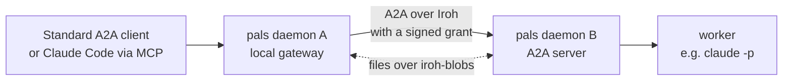

# PALS — Peer Agent Linking System

A peer-to-peer network where AI agents find each other, authorize each other and work together without depending on a central directory. Each agent runs a daemon, `pals`, which connects it to other agents, controls what they may ask of it and hands it the authorized work. Messages, tasks, their states, streaming and cancellation are [A2A](https://a2a-protocol.org/) v1.0: a standard A2A client reaches any peer through the local gateway with the JSON-RPC and HTTP+JSON bindings, and between peers those same bindings travel inside PALS's own binding, `http-over-iroh/v1`. File bytes travel separately, over iroh-blobs, outside A2A; A2A messages name them with a URL.

Before delegating, an agent can choose among the providers it knows: it verifies their signed Agent Cards, reads their inventories as its grants allow and asks them for offers over PALS's own discovery protocol, `agentnet-discovery/0`. No query runs any work; the chosen provider then gets the task over standard A2A, as before.

> **Status.** PALS is a prototype; read the known limitations of [milestone 1](#known-limitations-of-milestone-1) and [milestone 2](#known-limitations-of-milestone-2) before using it. Milestones are called *hitos* in the Spanish documentation.
>
> - **Works today: milestone 1 (hito 1).** Implemented and reviewed. A2A conformance, with the exact scope set by the [conformance report](docs/conformance/hito-1/README.md#lo-que-queda-respaldado), is backed by the official conformance kit (TCK) and the official Python SDK. The [exit test](docs/conformance/hito-1/exit-test.md) passed all eight cases with a Docker container playing the second machine, with real network cuts and the public relays, but on a single physical host.
> - **Implemented on `feat/hito-2`: milestone 2 (hito 2), service queries and inventory.** All 13 tasks of its plan, in draft [PR #2](https://github.com/rosepetal-ai/rosepetal-pals/pull/2), stacked on milestone 1. The [exit test](docs/conformance/hito-2/exit-test.md) passed its cases 1 to 8 with one Docker container per agent, on a single host, and case 9, the A2A conformance rerun, with no regression ([conformance report](docs/conformance/hito-2/README.md)).
> - **Pending the project owner:** accepting `AUTH-TLS-001`, deciding whether the Docker runs are enough or the exit tests are repeated on physical machines, and merging milestones 1 and 2 into `dev`.

The design document calls the protocol "Agentnet"; that is why the identifiers that travel over the network keep the `agentnet` prefix (`agentnet.grant/1`, `agentnet-a2a-http/1`, `agentnet-discovery/0`, `x-agentnet-peer`). The product, the binary and the crates are called `pals`.

## What milestone 1 does

- **Identity.** One Ed25519 key per agent, which is also the key of its [Iroh](https://www.iroh.computer/) endpoint. The agent id is that public key as 64 hexadecimal characters.
- **Connection.** Daemons talk over QUIC with Iroh, directly or through a relay.
- **Authorization.** Signed *grants* (canonical JSON, JCS, and Ed25519) that say who may ask for what, in which project and until when. They can be revoked. They tolerate 60 s of difference between clocks.
- **A2A v1.0.** Each daemon is a full A2A server, built with the official Rust SDK, with the JSON-RPC and HTTP+JSON bindings and streaming over SSE. Between peers, those same HTTP requests travel inside Iroh streams.
- **Local gateway.** Any standard A2A client reaches any peer at `http://127.0.0.1:7420/peers/<peer>/…`; the gateway adds the grant and tunnels the request.
- **Files.** They travel separately, with iroh-blobs and outside A2A, verified with BLAKE3; in A2A messages they are parts with a URL. Whoever holds a file decides who downloads it: knowing the hash gives no access.
- **Worker.** Incoming work is done by an adapter: `echo`, `exec` (any command, such as `claude -p`, in the project directory) or `tck` (only for the conformance tests).
- **Reliable questions.** `pals ask` stores each question before sending it, retries and resubscribes without running the work twice.
- **MCP.** A local MCP server, so that an AI application such as Claude Code can work with peers; with milestone 2 it serves eight tools (see [Connecting an MCP client](#connecting-an-mcp-client)).
- **Local store.** SQLite with tasks, contacts, grants, revocations, deduplication and a signed, hash-chained event log.



## What milestone 2 adds

Service queries and inventory: before delegating, an agent chooses among several providers it knows, and no query runs any work. The task itself is still sent with the standard A2A bindings of milestone 1.

- **Signed Agent Cards.** Each daemon signs its card with JWS `EdDSA` and its own Ed25519 key (A2A §8.4); the official Python, Go and JS SDKs verify it ([independent verification](docs/conformance/hito-2/card-signatures.md)). The public card lists the services the inventory shows everyone; the extended card (`GetExtendedAgentCard`) adds those the caller's grant lets it see. A peer's card is used only when its signature verifies with the key that Iroh's handshake proved.
- **Inventory.** `inventory.toml`, next to `config.toml`, in the format `agentnet.inventory/1` ([extension `inventory/v1`](docs/extensions/inventory-v1.md)): the services, which become skills of the card, and the skill packages, plugins, MCP connections, runtime, models, information sources, hardware and network behind them. Every block is optional, and what is left out is unknown, never zero. Each entry says who sees it: everyone, a grant for a project, a grant to send tasks in a project, or nobody.
- **Views by permission.** A peer reads only what its grant lets it see, in signed pages chained by cursors (`agentnet.inventory-view/1`). Views are cached per authorization context, and a public view carries no count or hash of what it hides.
- **Discovery protocol.** [`agentnet-discovery/0`](docs/protocols/agentnet-discovery-0.md), on an Iroh ALPN of its own: inventory pages, service queries and benchmark reports, each answer with the agent's signed contact and announce records. Answering reads metadata only: it never reaches the worker, an MCP tool or another peer. Quotas per peer and for all peers bound it.
- **Service queries and offers.** A query (`agentnet.service-query/1`) names a capability, media types and requirements. The candidate matches it against its own metadata, with no model and no tool, and answers with a signed offer (`agentnet.service-offer/1`) bound to that query and that requester, valid 15 s by default. An offer reserves nothing and authorizes nothing: the task still needs the grant, and the provider checks the offer again when the task arrives.
- **Benchmark reports.** Existing reports, signed by whoever measured (`agentnet.benchmark-report/1`), imported with `pals benchmark import`. Reading one never measures anything; an inventory view marks what has no report `no_measurement`, never a zero, and a search ranks it with no benchmark.
- **Two-stage selection.** `pals discover` searches the contacts: first it discards by card (capability and media types), then it asks the rest for offers and ranks them, within the design's limits: 8 candidates, 3 queries at a time, 3 s per candidate and 15 s in all by default (`[discovery]` in `config.toml`). It prints the ranking, every discard with its reason, the coverage and the metrics. With `--ask`, the question goes to the best candidate that takes it, naming its offer in the A2A message's metadata.
- **MCP inventory adapter.** For each MCP connection with an adapter, the daemon checks that the server really serves the tools offered: MCP `initialize` and `tools/list`, never `tools/call`, at start, every `refresh_interval_s` (900 s by default) and on `pals inventory refresh`. A declaration is never taken as proof that something works.
- **Plain A2A agents as contacts,** outbound only ([below](#plain-a2a-agents-as-contacts)).
- **Store schema 2.** A milestone 1 data directory is upgraded when it is first opened, and keeps its contacts, grants, tasks and events.

## Installation

Rust 1.91 or later (edition 2024):

```bash
cargo install --locked --path crates/pals
pals --help
```

## Quick start

Two agents, A and B, each on its own machine. On each one:

```bash
pals init            # creates ~/.pals/config.toml and the agent key
pals daemon          # in another terminal: serves peers and opens the local gateway
pals id --ticket     # with the daemon running: the ticket the other agent saves
```

They save each other as contacts, and B gives A permission:

```bash
# On A
pals contact add '<ticket of B>' --name b
# On B
pals contact add '<ticket of A>' --name a
pals grant issue --to a --project demo --ttl 24h     # prints the grant token
# On A
pals grant import '<token>'
pals ask b "How are you?"
```

With the default configuration, B answers with the `echo` adapter. To have Claude Code answer about a project, replace the `[worker]` section of B's `~/.pals/config.toml` with the one below (do not append it: a second `[worker]` is a TOML error) and add the project:

```toml
[worker]
adapter = "exec"
command = "claude"
args = ["-p", "--output-format", "text"]

[projects.demo]       # the grant's project
path = "/path/to/project"
```

The command runs in the directory of the grant's project, receives the question on stdin and answers on stdout, which reaches the asking peer as is; if it fails, that peer also receives the last 4 KiB of its stderr as the reason. Attached files are in `$PALS_IN_DIR`, and the files it leaves in `$PALS_OUT_DIR` (32 at most) come back as files of the answer. `pals init` writes the file with every option and its explanation.

More commands:

| Command | What it does |
|-|-|
| `pals ask <peer> "<question>" [--attach FILE]… [--wait 600s]` | Asks and waits for the answer. Writes the `messageId` to stderr as soon as it stores the question, so it can be resumed if the command is interrupted. Exits with `0` if the task completes, `2` if it fails, is rejected or is canceled, and `3` if the peer does not answer or the wait runs out; in that case the question stays stored. To a [plain A2A agent](#plain-a2a-agents-as-contacts) whose card cannot be read through the gateway when asked, or does not declare streaming, it exits with `1`, nothing kept and nothing asked |
| `pals task ls` · `pals task resume <messageId>` · `pals task cancel <messageId>` | The questions asked; resume one without running it twice (but see the [plain A2A agents](#plain-a2a-agents-as-contacts) that do not declare `idempotency/v1`); cancel its task |
| `pals contact ls` | The saved peers |
| `pals grant ls [--issued \| --held]` · `pals grant revoke <grant_id>` | Grants issued and held; revoke an issued one |
| `pals id` | The agent's id |

Everything lives in `~/.pals`, or in the directory given by `$PALS_HOME` or `--home`: `config.toml`, `inventory.toml`, the key (`agent.key`), the store (`pals.db`), the blobs and the tasks' working directories. For two agents on the same machine, use two directories with gateways on different ports.

Between two machines, `net.relay = true` is required; it is the default. The full procedure for testing it, case by case, is in the [two-machine exit-test runbook](docs/runbooks/hito-1-dos-maquinas.md). The harness in [`tests/exit/`](tests/exit/README.md) runs it on a single Linux host, with a Docker container as the second machine.

### Choosing a provider (milestone 2)

Each provider describes in `~/.pals/inventory.toml` what it offers and with what; `pals init` writes the file with a commented example of every block. The daemon reads it only when it starts. A requester that holds contacts and grants, as above, searches among them and asks the best one:

```bash
pals discover --capability code.rust.review --requirements-file req.json --project demo --ask "Review src/lib.rs"
```

`req.json` holds the requirements, such as `{"external_cloud_allowed": false, "inventory": {"required": {"mcp_integration_ids": ["example:everything"], "min_offered_ram_mib": 4096}}}`. Inventory ids go only to the candidates of which this agent holds a grant for `--project`: without `--project`, they go to no one, and a required one counts as not met. Without `--ask`, the command only searches; `pals ask <peer> "<question>" --offer <offer_id>` then asks with one of the offers it printed.

| Command | What it does |
|-|-|
| `pals discover --capability <id> [--input MIME]… [--output MIME]… [--requirements-file FILE] [--project P] [--peer PEER]… [--ask "<question>"] [--wait 600s]` | Searches the contacts for a provider: verifies their cards, asks the PALS peers for offers and prints the ranking, with each offer's id and expiry, every discard with its reason, the coverage and the metrics. It runs nothing on any peer. With `--ask`, it asks the best candidate that takes the question, and exits as `pals ask` does |
| `pals ask <peer> "<question>" --offer <offer_id>` | Asks naming an offer that `pals discover` printed; with an offer that expired by this agent's clock, it sends nothing and exits with `2` |
| `pals query <peer> --capability <id> [--input MIME]… [--output MIME]… [--requirements-file FILE] [--project P]` | Asks one PALS peer for an offer and prints it as the peer signed it; asking runs nothing, and the offer authorizes nothing. Without a grant of the peer's for the project, or without a project, the query goes without the project and without inventory ids |
| `pals card show [<peer>] [--extended]` | This agent's signed card, or a peer's, verified; with `--extended`, the peer's extended card as this agent's grant lets it see it |
| `pals inventory show [--scope public\|project:<p>\|task:<p>] [--sections …]` | What a peer of that scope sees of this agent's inventory |
| `pals inventory get <peer> [--sections …] [--all]` | A peer's inventory as this agent's grant lets it see it, each page as the peer signed it |
| `pals inventory refresh` | Checks the MCP connections the inventory configures now (`tools/list`, never a tool call) |
| `pals benchmark import <file> [--visibility …]` · `pals benchmark ls` | Keeps a signed benchmark report, as its measurer signed it, and says who sees it; lists those kept |
| `pals contact add-a2a <url> --name <name> [--bearer-env VAR]` | Saves a [plain A2A agent](#plain-a2a-agents-as-contacts) as a contact |

The [milestone 2 exit-test runbook](docs/runbooks/hito-2-consulta-de-servicios.md) sets up one requester and several providers, a real MCP server among them, case by case; [`tests/exit/hito-2.sh`](tests/exit/README.md#prueba-de-salida-del-hito-2-con-docker) runs it with one Docker container per agent.

## Connecting an MCP client

The MCP server is on the gateway, at `http://127.0.0.1:7420/mcp` (Streamable HTTP). With Claude Code:

```bash
claude mcp add --transport http pals http://127.0.0.1:7420/mcp
```

It serves eight tools; `pals_discover` and `pals_inventory`, and `offer_id` in `pals_ask`, came with milestone 2:

| Tool | What it does |
|-|-|
| `pals_whoami` | This agent's id, name and ticket |
| `pals_contacts` | The saved contacts, PALS peers and plain A2A agents, and whether a grant is held for each PALS peer |
| `pals_discover` | Searches the contacts for a provider of a capability, as `pals discover` does, without asking any of them to do anything: the candidates ranked, each with its offer and `offer_id`, those discarded with the reason, the coverage and the metrics |
| `pals_inventory` | A page of a PALS peer's inventory, as the peer shows it to this agent, verified; `cursor` asks for the next one |
| `pals_ask` | Asks a peer, with files if needed, and waits `wait_s` seconds: 50 by default, 3600 at most. With `offer_id`, the question names that offer of the peer's, as `pals_discover` returned it; with one that expired, nothing is sent |
| `pals_task` | Resumes a question by its `message_id` without running it twice (to a plain A2A agent, only if it declares `idempotency/v1`) |
| `pals_cancel` | Cancels a question's task |
| `pals_fetch` | Downloads a file from an answer to a new file in the downloads directory |

What peers send (offers, cards, inventory entries, answers) reaches the AI as data in the JSON of a result, never as instructions, and the tools' descriptions say so.

`pals_ask` waits 50 s by default, less than the maximum call time of common MCP clients, and the wait includes uploading the attachments; if the answer takes longer, it returns the `message_id` and the AI continues with `pals_task`. A call that the client cancels before the question is stored asks nothing. The CLI waits 600 s.

`pals_fetch` only writes inside the downloads directory, `[mcp] download_dir` in `config.toml` (`~/Downloads/pals` by default, created with `0700` permissions the first time and never inside the data directory): a file name, a relative path inside it, or an absolute path that, once resolved, stays inside, in a directory that already exists or in the downloads directory itself; no component may start with a dot, and it never overwrites. The MCP server's instructions tell the AI which directory it is.

## Standard A2A clients

Any A2A client talks to the peer `<peer>` (a contact name or an id) through the local daemon's gateway:

| Resource | URL |
|-|-|
| Agent Card | `http://127.0.0.1:7420/peers/<peer>/.well-known/agent-card.json` |
| Signed Agent Card, as the peer signed it, for tools that check the signature | `http://127.0.0.1:7420/peers/<peer>/signed-agent-card.json` |
| JSON-RPC | `http://127.0.0.1:7420/peers/<peer>/jsonrpc` |
| HTTP+JSON | `http://127.0.0.1:7420/peers/<peer>/rest` |
| Files | `GET http://127.0.0.1:7420/blobs/<holder>/<hash>` to download; `POST http://127.0.0.1:7420/blobs` to upload |

The gateway adds the most recent grant it holds for that peer. Every A2A request carries `A2A-Version: 1.0`, as a header or as a request parameter.

The gateway never forwards a peer's answer as is. Whether the client expects a JSON document or an SSE stream is decided by the client's own request (the JSON-RPC method or the HTTP+JSON route), never by the peer's `Content-Type`. It reads the answer with a limit of 16 MiB per body, or per SSE event before the stream ends; a successful answer (`2xx`) and the data of each event must be JSON, without unsafe task identifiers: not in `taskId`/`task_id`, not in `referenceTaskIds`/`reference_task_ids`, and not as the `id` of any object (except the envelope of a JSON-RPC response in the JSON-RPC binding, and whatever is inside `metadata`, `data` and `details`), because an id such as `../../../<another peer>/rest/tasks/x` would take the client, when it normalizes the URL, to another peer with the grant the gateway holds for that one. What reaches the client is the gateway's own encoding of what it checked: ASCII-only JSON, and each event as `data: <JSON>` (without the peer's `event:` or `id:` fields or comments; an event without data arrives as `:`, and one that the peer cuts off before its blank line does not arrive, as SSE requires). A rejected answer arrives as `502 {"error":"peer protocol error"}`; a rejected stream is cut before the offending event. A PALS peer never sends any of that. An error answer (not `2xx`) that is no JSON goes on as it came but typed by the gateway, as text, never as an event stream, so that no client takes a task from an error page; a plain A2A agent's is replaced by the gateway's own, which names only the status, and on a plain agent's JSON-RPC route the gateway's own refusals come as JSON-RPC errors (`-32091` for a refusal, `InternalError` for a failure on the way, `408` and `429` among them, `-32090` for "nothing was sent"). A JSON-RPC batch that asks for the extended card is refused before anything is sent, with a JSON-RPC `InvalidRequest` (`-32600`): ask for it alone. When re-encoding, a JSON number that does not fit exactly in a 64-bit integer or an `f64` loses precision.

`ListTasks` returns tasks from the most recently updated to the oldest, paginates with an opaque cursor and omits artifacts unless `includeArtifacts: true` is set (A2A §3.1.4); the pinned Rust SDK does not, and PALS corrects it in its store.

### Plain A2A agents as contacts

An agent with no PALS daemon, reached over HTTPS, can be saved as a contact and asked, outbound only: `pals contact add-a2a https://agent.example --name helper [--bearer-env HELPER_TOKEN]` reads and checks its card (`<url>/.well-known/agent-card.json`, or the card's own URL), and `pals ask helper ...`, `pals_ask` and `http://127.0.0.1:7420/peers/helper/...` reach it as they reach a peer: the PALS client asks it on its HTTP+JSON binding, or on JSON-RPC when its card declares no HTTP+JSON interface. `http://` is accepted only for `127.0.0.1`, `[::1]` and `localhost`, and never this agent's own gateway, a loopback host on its port, which would make an alias of a PALS peer riding its grant. Only the card's interfaces on the origin of the URL given are ever called, with no proxy and no redirects; the card is read again at every use (at most 32 KiB), and its JWS signature is reported (`verified <kid>` with an Ed25519 key of a JWK Set on the same origin, `unverifiable` or `unsigned`), not required. The only credential is a bearer token read from the named environment variable when a request is sent, in the environment of the daemon that sends it, not of the shell that runs `pals ask`; the token is never saved, and no grant is ever sent. It is asked for uncompressed answers (`Accept-Encoding: identity`) whatever the client accepts, and its answers go through the same checks as a peer's, except that its `iroh-blob://` URLs stay as sent: no blob is fetched or served on a plain agent's word.

In `pals discover`, a plain agent is a candidate only when its card's signature verifies and it declares streaming; it gets no service query, so it is ranked by its card alone, and a search that asks for anything a card cannot confirm (inventory, region, cloud, language) discards it. It can still be asked by name.

Limitations: files cannot be sent to a plain agent (`attachments need a PALS peer`); one whose card does not declare `capabilities.streaming = true` cannot be asked by `pals ask`, `pals_ask` or `pals discover --ask` in milestone 2, which refuse it before sending anything (`contact add-a2a` says so when it saves it), though stock A2A clients can still reach it through the gateway; the PALS client activates `idempotency/v1` as with a peer, but a plain agent may ignore it: unless its card declares the extension, a question goes to it again on its own only when it certainly never reached it: the outbox's own connection to the gateway could not be made, or the gateway said back the nonce that very send carried. Every send to such an agent carries a new nonce, 128 random bits, in the `x-agentnet-not-sent-nonce` header; the gateway never forwards it, and says it back only in its own `plain agent unreachable: nothing was sent to it`, when it could not reach the agent and sent it nothing. The agent never sees the nonce, so nothing it answers can make a question go again. Any other failure before its task is known (a refusal of its answer by the gateway, a `5xx`, a `408` or a `429`, an `InternalError`, a stream cut after sending) leaves the question pending, saying so; `pals task resume` sends it again when asked, and that can run it twice. A pending question follows its contact's name: re-pointing a plain contact (`contact add-a2a <new url> --name <same name>`) with a question pending sends it, with the contact's bearer token, to the new origin on `pals task resume`.

## A2A compatibility

What is backed, as established by the conformance reports of [milestone 1](docs/conformance/hito-1/README.md) and [milestone 2](docs/conformance/hito-2/README.md):

> **A2A v1.0 with the JSON-RPC and HTTP+JSON bindings through the local gateway; between peers, the custom binding `http-over-iroh/v1` (`…/v1/jsonrpc` and `…/v1/http-json`), which carries those same bindings.**

The official TCK (`a2aproject/a2a-tck` at `104a7b4ae0d8`), run through the gateway, leaves no failed automated MUST requirement in `jsonrpc` or in `http_json` (72 passed; the skipped ones are skipped for capabilities PALS does not declare, for preconditions that do not hold or for being gRPC), and the official Python SDK completes its 4 checks over both bindings. One `MANUAL` MUST-level requirement, `AUTH-TLS-001`, is still pending and needs the project owner's explicit acceptance. Not backed: the 16 MUST requirements without an automated test in the TCK, the `MANUAL` ones and the SHOULD `HTTP_JSON-SVC-001`. The details, and the workarounds for defects of the pinned Rust SDK, are in the reports.

Milestone 2 reran both with no regression. Two requirements changed state, both because the card now declares an extended card: `CARD-EXT-001` (an authenticated `GetExtendedAgentCard` returns the extended card) now passes, and `CORE-CAP-003`, which the TCK runs only when no extended card is declared, is now skipped. The card a daemon serves its peers is signed with JWS (A2A §8.4), which the TCK leaves to manual checks (`CARD-SIGN-001` to `004`); the official Python, Go and JS SDKs verify it ([card signatures](docs/conformance/hito-2/card-signatures.md)).

Between peers, the Agent Card declares two interfaces, one per inner binding, specified in [`docs/bindings/http-over-iroh-v1.md`](docs/bindings/http-over-iroh-v1.md):

| Inner binding | Binding URI | Interface URL |
|-|-|-|
| JSON-RPC | `https://github.com/rosepetal-ai/rosepetal-pals/bindings/http-over-iroh/v1/jsonrpc` | `iroh://<agent_id>/jsonrpc` |
| HTTP+JSON | `https://github.com/rosepetal-ai/rosepetal-pals/bindings/http-over-iroh/v1/http-json` | `iroh://<agent_id>/rest` |

Both use the Iroh ALPN `agentnet-a2a-http/1`. The local gateway presents the same two interfaces to standard clients as `JSONRPC` and `HTTP+JSON`, with an `http://` URL.

Idempotency by `messageId` is an optional A2A extension, [`idempotency/v1`](docs/extensions/idempotency-v1.md), which the PALS client always activates. The card also declares the extension [`inventory/v1`](docs/extensions/inventory-v1.md) (`https://github.com/rosepetal-ai/rosepetal-pals/extensions/inventory/v1`): its views, queries and offers travel over `agentnet-discovery/0`, outside A2A, and the PALS client activates it when a question names an offer, which the provider then checks again. A request that does not activate it is served as in milestone 1.

## Known limitations of milestone 1

- **No local authentication.** Any operating-system user on the machine can reach the loopback gateway and MCP server and act with this agent's grants and file access: ask its peers on its behalf, download the blobs in its store, attach through MCP any regular file that the daemon's user can read (except those in its data directory and those in `/proc`, `/sys`, `/dev` or on a procfs or sysfs file system) and write new files with `pals_fetch` inside the downloads directory. The gateway only rejects requests from browsers and `Host` values that are not loopback.
- **Worker commands run as the daemon's user** and can read its data directory, including the agent key (`agent.key`) and the database (`pals.db`). A command such as `claude -p`, which acts on what a peer asks, could read them.
- **The asking peer receives the command's output.** Its stdout is the answer and, if the command fails, the last 4 KiB of its stderr go into the failure reason: whatever the command writes to either one (paths, traces, secrets) reaches the peer.
- **Blobs do not expire.** Files uploaded to the gateway and those an agent sends in its answers are kept in its store with no retention policy; disk usage only grows.
- **`AUTH-TLS-001` pending.** The local gateway speaks HTTP without TLS on loopback; between peers, traffic is encrypted with QUIC's TLS 1.3. The project owner's explicit acceptance is missing.
- **Different waits in MCP and in the CLI.** `pals_ask` and `pals_task` wait 50 s by default (`wait_s`, at most 3600); `pals ask` and `pals task resume`, 600 s (`--wait`).
- **Idempotency is an optional extension.** A standard A2A client that retries with the same `messageId` without activating `idempotency/v1` can run the work twice, as with the reference SDK. The PALS client always activates it.
- **`A2A-Version` is mandatory in both bindings**, as a header or as a request parameter. Without it, the request counts as version `0.3` and is rejected with `VersionNotSupportedError`.
- **iroh-blobs maturity.** iroh-blobs 0.105.0 states in its README that it is not yet considered production quality. It is used because the version recommended for production, 0.35, is not compatible with iroh 1.x.
- **The worker clears the environment.** Commands only inherit `PATH`, `HOME` and `LANG` (plus the task's `PALS_*` variables), so `ANTHROPIC_API_KEY` does not get through: `claude -p` needs its credentials under `HOME`, or a wrapper script that exports the key.
- **Two machines need `net.relay = true`.** With `relay = false` the daemon binds only to `127.0.0.1`, and its port changes on every start: the tickets its peers saved stop working.
- **A daemon killed with `SIGKILL` can leave the commands it was running alive**, with their process group. On restart, their tasks end as `TASK_STATE_FAILED` (`interrupted: daemon restarted`), but the commands must be terminated by hand. A process that a command moves out of its group (with `setsid`) also escapes the timeout and cancellation.
- **One grant per peer.** With several grants from the same peer, the gateway uses the most recent one: the project is not chosen question by question. Since milestone 2, an ask that names an offer presents the grant of the offer's scope instead.
- **Minimal logging.** The daemon writes to stderr its start, its stop, pending questions and its diagnostics from the `INFO` level up (`RUST_LOG` changes it, e.g. `RUST_LOG=pals=debug`); it does not report the network path (direct or relay).

Outside milestone 1: the signed card (JWS) and the service inventory (milestone 2, below).

## Known limitations of milestone 2

Those of milestone 1 still hold, and:

- **No DHT.** A search reaches only the agents already saved as contacts. Contact and announce records are signed, kept and sent with every discovery answer, but nothing publishes them yet: discovery of unknown peers is milestone 3.
- **Discovery quotas are per agent id.** A peer's `agentnet-discovery/0` streams and requests are limited per `AgentId` (4 streams and 60 requests a minute), and to 64 streams in all; Iroh identities cost nothing, and there is no global budget for requests without a grant. Such a request writes nothing to the store: only an offer a task can name, of a `task:<project>` scope, is kept.
- **No clarifications.** A candidate whose offer lacks the information to confirm a mandatory requirement (`needs_information`) is discarded; there is no exchange to clarify it. An unknown requirement is never met, and it discards.
- **Plain A2A contacts are outbound only and take no files.** In automatic selection (`pals discover`) they count only when their card's signature verifies, and they are ranked by their card alone; the PALS client asks only those whose card declares streaming, though stock A2A clients reach any of them through the gateway (see [above](#plain-a2a-agents-as-contacts)).
- **Foreign cards are verified in three canonical forms.** The official SDKs do not canonicalize a card the same way before checking its signature. PALS signs normalized cards, whose three forms are the same bytes, and accepts a foreign card whose valid signature covers any of the three, so a card that PALS accepts may fail in one of the SDKs ([card signatures](docs/conformance/hito-2/card-signatures.md)).
- **Changing `inventory.toml` needs a daemon restart.** The inventory is read once, when the daemon starts; there is no live reload. Only the observations of the MCP adapters change while it runs.
- **MCP adapter response size.** Over `http`, rmcp 3.10 caps a plain JSON response of an MCP server at a fixed 16 MiB, which PALS cannot lower; the lines of a `stdio` server and the events of an HTTP stream are held to 1 MiB.

Outside milestones 1 and 2: discovery of unknown peers (milestone 3), and *push* notifications, the gRPC binding and direct HTTPS access for clients without a PALS daemon (no milestone yet).

## Roadmap

Four milestones, in the order of the [design](docs/plans/initial.md) (§14). In all of them, the final task is still sent with standard A2A v1.0, as in milestone 1. The [roadmap document](docs/plans/2026-11-14-hoja-de-ruta-hitos-2-4.md) has the detail: the planned tasks, how each milestone is closed, the risks and the decisions still to take.

**1. Basic flow: implemented.** Two agents connect and authorize each other, and one asks the other for work, with files, without duplicating work across retries and network cuts.
- **Deliverable:** two daemons, identity, grants, an `ask`, MCP and worker, and a blob.
- **Exit criterion:** a useful question and an authorized transfer between two machines; retry and network cut without duplicating work.
- **Status:** implemented and reviewed; draft [PR #1](https://github.com/rosepetal-ai/rosepetal-pals/pull/1) against `dev`, CI green. The exit test passed 8 of 8 cases with a Docker container as the second machine; it did not cover two physical machines behind different NATs, or real Wi-Fi or mobile networks. Pending the project owner: `AUTH-TLS-001`, whether to repeat the test on two physical machines, and the merge.
- **Links:** [plan](docs/plans/2026-11-14-hito-1-flujo-basico-a2a.md), [conformance report](docs/conformance/hito-1/README.md), [exit test](docs/conformance/hito-1/exit-test.md), [runbook](docs/runbooks/hito-1-dos-maquinas.md), [Docker harness](tests/exit/README.md).

**2. Service queries and inventory: implemented.** Before delegating, an agent chooses among several known providers: it validates their signed Agent Cards, reads their inventories as its permissions allow and asks them whether they can handle its case, without any query running work.
- **Deliverable:** Agent Cards, filtered inventories, existing benchmark reports, `ServiceQuery` and `ServiceOffer`.
- **Exit criterion:** choose among at least three candidates; check requirements on integrations and resources; validate cards; run no work when querying.
- **Status:** the 13 tasks of the plan implemented on `feat/hito-2`; draft [PR #2](https://github.com/rosepetal-ai/rosepetal-pals/pull/2), stacked on milestone 1. The exit test passed 8 of 8 cases with one Docker container per agent, on a single host, and case 9, the conformance rerun, with no regression; it did not cover several physical machines or networks. Pending the project owner: whether to repeat the test on physical machines, and the merge.
- **Links:** [plan](docs/plans/2026-11-14-hito-2-consulta-de-servicios.md), [conformance report](docs/conformance/hito-2/README.md), [exit test](docs/conformance/hito-2/exit-test.md), [runbook](docs/runbooks/hito-2-consulta-de-servicios.md), [Docker harness](tests/exit/README.md#prueba-de-salida-del-hito-2-con-docker), [independent verification of the card signature](docs/conformance/hito-2/card-signatures.md).

**3. Discovery with Kademlia: planned.** Find providers without prior contact, over a backend chosen after a bounded comparison.
- **Deliverable:** a bounded comparison of the backend, a capability registry and contact resolution.
- **Exit criterion:** justify the chosen implementation; find a provider without prior contact; work without the original bootstrap node, and expire announcements.
- **Status:** no plan yet. It is written now that milestone 2 is built, and the backend comparison decides the rest.

**4. Private collaboration with P2panda: only if a real case appears.** Several authorized nodes keep a project's private catalog in sync without publishing it, even when they are not online at the same time.
- **Deliverable:** a bounded trial of P2panda, if there is a need for replication.
- **Exit criterion:** sync a private catalog without publishing it; control additions, removals and permissions across disconnections.
- **Status:** it is planned only when a case appears in which the local catalog or store is not enough (design §11 and §14).

## Documentation

The documentation under `docs/` is in Spanish.

- [`docs/plans/initial.md`](docs/plans/initial.md): the network design, revision 3.
- [`docs/plans/2026-11-14-hito-1-flujo-basico-a2a.md`](docs/plans/2026-11-14-hito-1-flujo-basico-a2a.md): the step-by-step plan for milestone 1, with the changes imposed by the A2A compatibility requirement.
- [`docs/plans/2026-11-14-hito-2-consulta-de-servicios.md`](docs/plans/2026-11-14-hito-2-consulta-de-servicios.md): the step-by-step plan for milestone 2, with its own spec-deviation table.
- [`docs/plans/2026-11-14-hoja-de-ruta-hitos-2-4.md`](docs/plans/2026-11-14-hoja-de-ruta-hitos-2-4.md): the roadmap for milestones 2 to 4.
- [`docs/bindings/http-over-iroh-v1.md`](docs/bindings/http-over-iroh-v1.md): the peer bindings.
- [`docs/extensions/idempotency-v1.md`](docs/extensions/idempotency-v1.md): the idempotency extension.
- [`docs/extensions/inventory-v1.md`](docs/extensions/inventory-v1.md): the inventory extension, with the JSON Schemas of its documents in [`docs/extensions/inventory-v1/`](docs/extensions/inventory-v1/).
- [`docs/protocols/agentnet-discovery-0.md`](docs/protocols/agentnet-discovery-0.md): the discovery protocol, with its messages in [`agentnet-discovery-0.proto`](docs/protocols/agentnet-discovery-0.proto).
- [`docs/conformance/hito-1/README.md`](docs/conformance/hito-1/README.md): A2A conformance (TCK and Python SDK), and [`sdk-issues.md`](docs/conformance/hito-1/sdk-issues.md), the defects of the Rust SDK.
- [`docs/runbooks/hito-1-dos-maquinas.md`](docs/runbooks/hito-1-dos-maquinas.md) and [`docs/conformance/hito-1/exit-test.md`](docs/conformance/hito-1/exit-test.md): the two-machine exit test, its run with Docker as the second machine ([`tests/exit/`](tests/exit/README.md)) and the earlier rehearsal on one machine.
- [`docs/conformance/hito-2/README.md`](docs/conformance/hito-2/README.md): the milestone 2 conformance rerun, requirement by requirement against milestone 1, and [`card-signatures.md`](docs/conformance/hito-2/card-signatures.md), the independent verification of the card signature.
- [`docs/runbooks/hito-2-consulta-de-servicios.md`](docs/runbooks/hito-2-consulta-de-servicios.md) and [`docs/conformance/hito-2/exit-test.md`](docs/conformance/hito-2/exit-test.md): the milestone 2 exit test and its run with one Docker container per agent.

## Technology

Rust (edition 2024, minimum version 1.91), tokio, iroh 1.4.1, iroh-blobs 0.105.0, the official A2A SDK for Rust ([`a2aproject/a2a-rs`](https://github.com/a2aproject/a2a-rs): `a2a-lf` 0.4.2, `a2a-server-lf` 0.5.3, `a2a-client-lf` 0.2.9), axum and hyper, rmcp 3.10.0 for MCP, and embedded SQLite (rusqlite 0.42). Versions are pinned with `=` in `Cargo.toml` and in `Cargo.lock`; upgrading any of them is an explicit change that requires rerunning the conformance tests.

## Contributing

The default branch is `dev`, and pull requests target `dev`. This README, `CLAUDE.md`, the code, identifiers, comments and commit messages are in English; the documentation under `docs/` is in Spanish. Before each commit:

```bash
cargo fmt --check
cargo clippy --workspace --all-targets -- -D warnings
cargo test --workspace --locked
```

Conformance is rerun with `tests/interop/run_tck.sh`, `tests/interop/python_client.py` and `tests/interop/check_schemas.py`; `PALS_CONFORMANCE_DIR=docs/conformance/hito-2` sends the TCK reports to the milestone 2 directory instead of `docs/conformance/hito-1` (see the [report](docs/conformance/hito-2/README.md#ejecución)). The exit tests are rerun with `tests/exit/run.sh` (milestone 1) and `tests/exit/hito-2.sh` (milestone 2), which need Linux with Docker and internet access (see [`tests/exit/README.md`](tests/exit/README.md)). Guidelines for coding agents are in [`CLAUDE.md`](CLAUDE.md).
