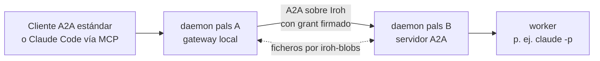

# PALS — Peer Agent Linking System

Red entre pares para que agentes de IA se encuentren, se autoricen y trabajen juntos sin depender de un directorio central. Cada agente ejecuta un daemon, `pals`, que lo conecta con otros agentes, controla qué pueden pedirle y le entrega el trabajo autorizado.

> **Estado:** en diseño e implementación. Aún no hay una versión utilizable. El hito 1 se construye en la rama `feat/hito-1`.

El documento de diseño llama al protocolo «Agentnet»; por eso los identificadores que viajan por la red conservan el prefijo `agentnet`.

## Qué hará el hito 1

- **Conectar agentes** por [Iroh](https://www.iroh.computer/) (QUIC, con conexión directa o por relay). La identidad de cada agente es su clave Ed25519.
- **Autorizar el trabajo** con *grants* firmados (JSON canónico JCS y Ed25519) que indican quién puede pedir qué, en qué proyecto y hasta cuándo. Se pueden revocar.
- **Enviar preguntas y tareas** con el protocolo [A2A](https://a2a-protocol.org/) v1.0 estándar: mensajes, tareas, estados, streaming y cancelación.
- **Mover ficheros grandes** fuera del canal de control con iroh-blobs, verificados con BLAKE3. Conocer el hash de un fichero no da acceso a él.
- **Integrarse con la aplicación de IA local** (por ejemplo, Claude Code) mediante MCP, y ejecutar el trabajo entrante con un adaptador configurable, como `claude -p`.
- **No duplicar trabajo** al reintentar, y recuperar las tareas tras cortes de red o reinicios.

## Compatibilidad con A2A

El objetivo es que el intercambio final sea completamente compatible con A2A v1.0:

- Un cliente A2A estándar habla con cualquier agente de la red a través del gateway local de su daemon (`http://127.0.0.1:7420/peers/<agente>/…`), con los bindings estándar JSON-RPC y HTTP+JSON.
- Entre daemons, esas mismas peticiones viajan sin cambios dentro de un stream de Iroh. Para A2A es un *custom protocol binding*, `http-over-iroh/v1`, declarado en la Agent Card.

La compatibilidad se dará por demostrada cuando el agente pase el kit de conformidad oficial de A2A (TCK) y una prueba con el SDK oficial de Python. Hasta entonces es un objetivo, no un resultado.

## Hoja de ruta

| Hito | Contenido | Estado |
|-|-|-|
| 1. Flujo básico | Dos daemons, identidad, grants, `ask`, MCP y worker, un fichero, intercambio A2A estándar | En curso |
| 2. Consulta de servicios e inventario | Agent Cards firmadas, inventario filtrado por permisos, consultas `ServiceQuery` y ofertas `ServiceOffer` | Planificado |
| 3. Descubrimiento | Encontrar proveedores sin contacto previo con Kademlia, tras comparar alternativas | Planificado |
| 4. Colaboración privada | Catálogos privados sincronizados con P2panda | Solo si aparece un caso real |

## Documentación

- [`docs/plans/initial.md`](docs/plans/initial.md): diseño de la red, revisión 3.
- [`docs/superpowers/plans/2026-11-14-hito-1-flujo-basico-a2a.md`](docs/superpowers/plans/2026-11-14-hito-1-flujo-basico-a2a.md): plan paso a paso del hito 1.
- [`docs/superpowers/plans/2026-11-14-hoja-de-ruta-hitos-2-4.md`](docs/superpowers/plans/2026-11-14-hoja-de-ruta-hitos-2-4.md): hoja de ruta de los hitos 2 a 4.

## Tecnología

Rust (edición 2024, versión mínima 1.91), iroh 1.4.1, iroh-blobs 0.105.0, el SDK oficial de A2A para Rust ([`a2aproject/a2a-rs`](https://github.com/a2aproject/a2a-rs)), rmcp 3.10.0 para MCP y SQLite embebido. Las versiones están fijadas; subir cualquiera es un cambio explícito que obliga a repetir las pruebas de conformidad.

> **Aviso de madurez:** iroh-blobs 0.105.0 indica en su README que todavía no se considera calidad de producción. Se usa porque la versión recomendada para producción, la 0.35, no es compatible con iroh 1.x.

## Contribuir

La rama por defecto es `dev` y las pull requests van contra `dev`. La documentación se escribe en español; el código, los identificadores y los comentarios, en inglés.
