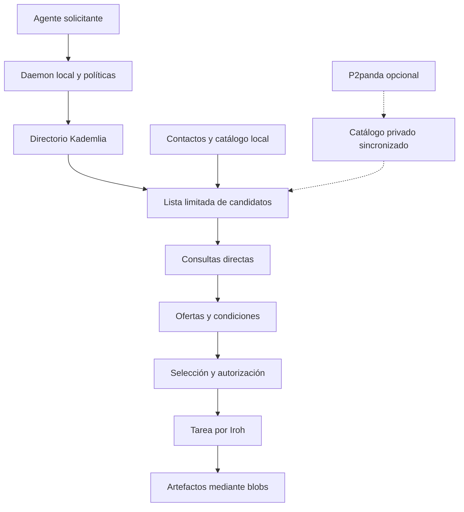

# Red de agentes: búsqueda descentralizada y colaboración

**Fecha:** 13 de noviembre de 2026.  
**Revisión:** 3 — inventario de capacidades, skills, plugins, MCP, modelos, información y benchmarks de hardware y red.  
**Estado:** propuesta de arquitectura y plan de implementación; no constituye un sistema probado.  
**Base:** evolución del documento «Red P2P de agentes de IA: arquitectura y contratos del MVP», revisión 2, de septiembre de 2026.

Este documento incorpora Kademlia como componente previsto para descubrir servicios públicos, consultas directas a candidatos inspiradas en Soulseek y una función opcional de P2panda para colaboración privada. Conserva un primer prototipo pequeño y separa los hitos posteriores.

Esta revisión prioriza reutilizar las Agent Cards de A2A, mantiene Iroh e iroh-blobs para el primer prototipo y considera provisional la incorporación de libp2p como segunda pila de red. La combinación debe validarse con versiones concretas, pruebas de interoperabilidad y una comparación acotada del descubrimiento; todavía no se ha demostrado que sea la mejor combinación para este producto.

Se incorpora un inventario ampliado y opcional por agente, vinculado a su Agent Card y filtrado según el solicitante. El formato de descripción será común, pero el catálogo de servicios será abierto: cada agente podrá describir capacidades propias, integraciones, modelos, fuentes de información y recursos. Los benchmarks indicarán cómo, cuándo y por quién se midieron; no se confundirán con disponibilidad actual ni con permisos.

## 1. Explicación en pocas frases

Cada agente podrá anunciar qué sabe hacer en una red que no depende de un único directorio. **Kademlia servirá para encontrar candidatos**, como proveedores de OCR, revisión de código o análisis de datasets. Después, el solicitante **preguntará directamente a unos pocos candidatos** si pueden resolver su caso concreto, en qué condiciones y con qué disponibilidad.

El agente elegido ejecutará la tarea con permisos explícitos; los archivos grandes viajarán por un canal separado y se comprobarán mediante hashes. **P2panda podría mantener sincronizados los catálogos y eventos de un equipo privado** cuando esa necesidad exista. No será obligatorio para buscar servicios ni para construir la primera demostración.

La búsqueda podrá combinar lo que el agente sabe hacer con las herramientas, modelos y recursos que ofrece: por ejemplo, un agente con acceso autorizado a un repositorio, una skill de revisión de Rust y capacidad de ejecutar sus pruebas. El inventario detallado y las mediciones se consultarán directamente; la DHT conservará anuncios pequeños y públicos.

## 2. Decisiones de arquitectura

|Función|Decisión|Momento|
|-|-|-|
|Conectar agentes|Daemon Rust con Iroh|Primer prototipo|
|Identificar y autorizar|Claves Ed25519, grants JCS firmados y política local|Primer prototipo|
|Consultar conocimiento|Skill `ask`, con contexto y recursos acotados|Primer prototipo|
|Compartir archivos|iroh-blobs, hashes BLAKE3 y autorización en el proveedor|Primer prototipo|
|Conectar con aplicaciones de IA|Interfaz MCP local y adaptadores de ejecución|Primer prototipo|
|Representar trabajo|Subconjunto de tipos A2A sobre el protocolo propio|Primer prototipo|
|Describir agentes y servicios|Agent Card A2A como ficha principal; extensiones para lo que falte|Segundo hito|
|Describir recursos e integraciones|Inventario opcional de skills, plugins, MCP, modelos, información, hardware y red|Segundo hito, con campos opcionales|
|Comparar capacidad medida|Informes de benchmark con escenario, configuración, fecha y procedencia|Segundo hito: formato e informes existentes; medición activa solo si se autoriza|
|Comprobar si un servicio encaja|Consulta directa `ServiceQuery` y respuesta `ServiceOffer`|Segundo hito|
|Encontrar proveedores desconocidos|Kademlia; `libp2p-kad` es el candidato inicial, sujeto a validación|Tercer hito, previsto|
|Compartir catálogo e historial privados|Evaluar módulos de P2panda|Hito condicionado a un caso real|
|Pagos, reputación global, blockchain|Fuera del plan inicial|Sin compromiso de implementación|

La búsqueda pública y la colaboración privada tienen políticas diferentes. Encontrar un agente no concede acceso a sus archivos, conocimientos privados o herramientas.



Las flechas representan el flujo lógico. Kademlia no transporta las tareas ni los archivos. P2panda no participa en todas las búsquedas y no se convierte en una autoridad global.

### 2.1. Valoración de las tecnologías

La selección busca reducir el trabajo propio y permitir un primer flujo útil. La valoración siguiente es una decisión de diseño, no un benchmark ni una certificación de madurez.

|Pieza|Valoración y decisión|
|-|-|
|Rust e Iroh|Mantener para el daemon y la conectividad inicial; verificar conexiones directas y por relay|
|iroh-blobs y BLAKE3|Mantener para archivos grandes y transferencia verificada por rangos; comprobar versión y control de acceso|
|A2A|Reutilizar más del estándar: Agent Cards, tipos y reglas; separar conformidad de tipos de interoperabilidad real|
|MCP|Mantener como interfaz local; sigue haciendo falta un worker para ejecutar trabajo entrante|
|Kademlia|Mantener para localizar proveedores por claves de capacidad; no confundirlo con búsqueda semántica|
|Iroh más libp2p|Candidato pendiente de comparar: dos pilas implican más conexiones, configuración y mantenimiento|
|Consulta directa inspirada en Soulseek|Mantener como patrón; no requiere una librería Soulseek ni difusión global|
|Ed25519, grants JCS y SQLite|Mantener el esquema pequeño y los permisos directos; no añadir delegación o registro distribuido sin necesidad|
|P2panda|Evaluar solo cuando exista una necesidad concreta de sincronización privada|

La utilidad dependerá también del vocabulario de capacidades, los límites de ejecución, la prevención de tareas duplicadas y la comprobación de resultados. Añadir librerías no resuelve esas reglas de colaboración.

## 3. Contratos que se conservan del MVP

**A2A es la base del modelo de colaboración: mensajes, tareas, estados y resultados.** Las demás piezas cubren necesidades distintas:

|Pieza|Papel respecto a A2A|
|-|-|
|Kademlia|Encontrar proveedores antes de iniciar la interacción|
|Consulta directa inspirada en Soulseek|Comprobar si los candidatos pueden atender la necesidad concreta|
|Iroh|Proporcionar conectividad P2P y un canal para el intercambio|
|iroh-blobs|Transferir archivos referenciados por los mensajes|
|MCP|Dar al agente local herramientas para utilizar la red|
|P2panda|Sincronizar información privada compartida, si se incorpora|

**Compatibilidad actual del diseño:** el MVP reutiliza tipos y semántica de A2A, pero su transporte `agentnet/0` es experimental. No se presenta como A2A estándar interoperable de extremo a extremo. Para alcanzar esa compatibilidad habrá que completar y validar un binding que preserve las operaciones y reglas de A2A, o implementar un gateway convencional. Ese trabajo no se considera realizado por reutilizar los tipos protobuf.

**Dirección adoptada:** A2A debe ser la referencia de los contratos compartidos. Una Agent Card será la ficha principal del agente desde el segundo hito; no se diseñará primero una ficha equivalente para convertirla a A2A después. Los datos propios de la red se añadirán mediante extensiones documentadas o registros de anuncio separados. A2A ya define Agent Cards, skills y mecanismos de firma. [11][12]

El transporte propio se conserva como experimento del MVP, no como una decisión irreversible del producto. Antes de anunciar compatibilidad A2A se documentará el mapeo de operaciones, errores, estados y streaming, y se probará contra una implementación independiente que soporte el binding elegido. Un SDK estándar no podrá hablar directamente con `agentnet/0` sin un adaptador o gateway. Esta comprobación se realizará sobre un caso acotado; no exige construir dos productos completos para comenzar. [13]

1. **Una clave Ed25519 persistente por agente.** Las sesiones son un campo, no identidades nuevas. Inicialmente hay un agente por daemon y por endpoint Iroh.
2. **Grants directos firmados.** JSON canónico JCS, RFC 8785, y Ed25519; emisor aceptado localmente, sujeto, audiencia, proyecto, recursos, operaciones y caducidad. Sin delegación inicial.
3. **Protocolo de tareas `agentnet/0`.** Streams QUIC bidireccionales, frames protobuf con longitud `u32` big-endian y negociación de versión. Se mantienen límites, deduplicación, cancelación y recuperación por cursor del documento base.
4. **Tipos A2A seleccionados.** `Message`, `Part`, `Task` y `TaskStatus`, con sus dependencias. Reutilizar esos tipos no equivale a implementar todos los bindings y operaciones de A2A.
5. **SQLite local.** Tareas, contactos, grants, revocaciones, deduplicación y eventos firmados con autor, secuencia, hash previo y hash de payload.
6. **Bytes grandes fuera del canal de control.** Las referencias a blobs no otorgan permiso por sí mismas.

MCP es la interfaz entre la aplicación de IA y su daemon. No es el directorio de la red. Además del servidor MCP, se necesita un worker o adaptador que reciba el trabajo autorizado y lo ejecute en el runtime elegido.

Ese MCP local de Agentnet se distingue de los servidores MCP que el agente tenga conectados para consultar otras aplicaciones. Estos últimos podrán describirse selectivamente en el inventario de la sección 9; anunciarlos no expone sus credenciales ni habilita un proxy remoto de todas sus herramientas.

Esta revisión conserva los mensajes y grants congelados del protocolo de tareas. Sí modifica explícitamente la propuesta de descubrimiento, aún sin implementar: sustituye el descriptor propio por una Agent Card y adapta la consulta de esa ficha en la sección 10. Los formatos detallados y vectores del MVP permanecen en el documento base.

## 4. Tres preguntas distintas

|Pregunta|Operación|Resultado|
|-|-|-|
|¿Quién anuncia esta capacidad?|Descubrimiento|Candidatos y referencias a descriptores|
|¿Puedes resolver este caso, ahora y bajo estas condiciones?|Consulta de servicio|Oferta, incompatibilidad o necesidad de información|
|Resuelve esta pregunta o ejecuta esta tarea|Ejecución autorizada|Respuesta, estado y artefactos|

Una búsqueda de servicios no ejecuta automáticamente un `ask`, no descarga datasets y no inicia herramientas del agente remoto.

Ejemplo: buscar «OCR» devuelve candidatos. Preguntarles si admiten imágenes de metal, texto pequeño y procesamiento local permite descartar algunos. Enviar la imagen para que extraigan su texto es ya ejecución y requiere autorización adicional.

## 5. Kademlia como directorio de capacidades

### 5.1. Qué aporta y qué debemos añadir

Kademlia organiza la localización de claves mediante distancia XOR y tablas de contactos distribuidas. libp2p añade operaciones de almacenamiento de valores y anuncios de proveedores. Es una base para localizar registros; no incorpora por sí sola una búsqueda semántica de servicios. [1][2]

En nuestra aplicación, cada capacidad tendrá un identificador estable y una versión. El primer vocabulario puede ser pequeño:

```text
agentnet:capability:v1:vision.ocr
agentnet:capability:v1:vision.defect-detection
agentnet:capability:v1:code.rust.review
agentnet:capability:v1:knowledge.documentation
```

Estas cadenas son identificadores propuestos de nuestra aplicación, no claves estándar de libp2p. En la variante `libp2p-kad`, los provider records usarán una clave multihash derivada de la cadena canónica conforme a sus API. Otro backend de descubrimiento tendrá su propia codificación; no se supondrá que las claves ni los registros son intercambiables entre DHTs.

Las etiquetas comunes tendrán una definición publicada. Los proveedores podrán añadir capacidades propias con un namespace suyo, sin una entidad que apruebe cada alta. Los alias y traducciones se resolverán en el buscador del solicitante.

El vocabulario común sirve de ayuda para enrutar, no es una lista cerrada de servicios permitidos. Las descripciones, ejemplos y campos del inventario permiten especificar necesidades más precisas. Las operaciones `describe`, `ask`, `query` o `fetch` son posibles perfiles de uso, no una taxonomía obligatoria de todos los agentes ni métodos nuevos del estándar A2A.

### 5.2. Qué se publica

La DHT guarda **anuncios de proveedores de una capacidad** y registros de contacto verificables. La descripción completa del servicio se obtiene del proveedor o de una caché verificada por hash y firma.

|Registro|Contenido|Visibilidad|
|-|-|-|
|Proveedor de capacidad|Peer que anuncia una clave de capacidad|Público|
|Contacto|Relación verificable entre identidad libp2p, agente y endpoint Iroh|Público si se anuncia el servicio|
|Agent Card A2A|Skills, formatos, interfaces y requisitos de autenticación; extensiones cuando hagan falta|Pública o restringida, según el agente|
|Inventario ampliado|Integraciones, modelos, información, hardware y red que el agente ofrece|Consulta directa, con vista filtrada por permisos|
|Informe de benchmark|Métricas, escenario y evidencia de una medición|Directo o caché autorizada; sin resultados voluminosos en la DHT|
|Oferta de servicio|Disponibilidad y condiciones para una consulta concreta|Intercambio directo|
|Contexto, credenciales y datos de tarea|Entradas y permisos de ejecución|Solo participantes autorizados|

Un provider record estándar no contiene nuestra ficha completa ni demuestra la calidad del proveedor. En particular, no se guardará una única lista mutable compartida en `skill:ocr`: cada proveedor anuncia su propia presencia y el cliente reúne candidatos.

### 5.3. Búsqueda y filtrado

1. Traducir la necesidad a una o varias capacidades conocidas.
2. Buscar primero en contactos, caché y catálogos privados accesibles.
3. Consultar Kademlia cuando la política permita descubrimiento público.
4. Obtener un conjunto limitado de proveedores, deduplicado por identidad de agente.
5. Resolver y verificar el contacto y descriptor de cada candidato.
6. Aplicar filtros baratos antes de enviar consultas directas.

Los filtros detallados podrán pedir una skill instalada, una integración MCP, un modelo concreto, acceso a una fuente autorizada o un mínimo de capacidad disponible. Se evaluarán en contactos, catálogos privados o inventarios obtenidos directamente. La primera versión de Kademlia indexará categorías públicas amplias; no intentará indexar todas las combinaciones, rangos numéricos ni telemetría cambiante. Una consulta como «latencia menor de 100 ms» requiere mediciones pertinentes al solicitante, no solo una clave en la DHT.

Un resultado es un candidato, no una garantía de disponibilidad. Tampoco una búsqueda sin resultados demuestra que no exista ningún proveedor: puede haber anuncios ausentes, caducados, límites de enumeración o una partición de red.

### 5.4. Vocabulario y búsqueda semántica

«Leer matrículas», «extraer texto» y «OCR» pueden conducir a una capacidad común, pero esa equivalencia la aporta el buscador. Una primera implementación puede utilizar alias y reglas locales; después se podrían añadir embeddings para clasificar los descriptores obtenidos.

Hashear un embedding y buscar su clave en Kademlia no preserva la similitud semántica. Un índice de similitud distribuido sería otra pieza y no es necesario para este diseño inicial.

### 5.5. Caducidad, saturación y abuso

Los anuncios y contactos caducan y se renuevan. Los contactos llevan secuencia y firma para detectar alteraciones y regresiones conocidas. Una ficha antigua debe revalidarse directamente antes de ejecutar trabajo.

Se limitarán registros, consultas y tamaño por nodo; se buscará diversidad de rutas y proveedores. Una clave popular puede saturarse o devolver un conjunto sesgado. La partición de categorías y el muestreo de proveedores se añadirán cuando las mediciones lo justifiquen; no se promete enumeración exhaustiva.

Las firmas no evitan identidades falsas en masa ni ataques Sybil. La red abierta necesitará políticas de admisión y consumo, además de la criptografía.

## 6. Implementación de la DHT sin rehacer Iroh

### 6.1. Candidato inicial y alternativas

El candidato inicial es **un módulo `rust-libp2p` para Kademlia dentro del daemon**, manteniendo Iroh para consultas y tareas. `libp2p-kad` proporciona la implementación de Kademlia. La combinación queda pendiente de una prueba acotada de integración y coste; no se presupone un adaptador inmediato entre ambos transportes. [3]

|Alternativa|Ventaja que se evaluará|Coste o límite|
|-|-|-|
|Iroh e iroh-blobs más `libp2p-kad`|Aprovechar la transferencia de blobs y una implementación existente de Kademlia|Mantener dos pilas de conectividad y vincular sus identidades|
|Concentrar la red en libp2p|Reunir QUIC, Kademlia, relays y mecanismos para atravesar NAT|Replantear la transferencia de archivos; iroh-blobs no pasa a funcionar sobre libp2p automáticamente|
|Mantener Iroh y explorar su ecosistema Mainline DHT|Reutilizar mecanismos de resolución de direcciones y descubrimiento de contenido|No proporciona por sí solo nuestro índice de capacidades; parte del trabajo de contenido es experimental|

libp2p ofrece los componentes de conectividad citados, pero su disponibilidad no demuestra que la aplicación completa sea más sencilla o rápida. [14] Iroh dispone de resolución de direcciones mediante pkarr sobre Mainline DHT. Su propuesta experimental de descubrimiento de contenido utiliza además un índice para traducir direcciones `host:port` a identidades Iroh y reconoce límites de privacidad. [15][16]

Resolver una dirección conocida o encontrar proveedores de un hash no equivale a buscar agentes por servicio. Adoptar Mainline exigiría definir el índice de capacidades y verificar sus mecanismos de anuncio, identificación y abuso. No se sustituirá `libp2p-kad` por esta alternativa únicamente para reducir el número de dependencias.

**Decisión provisional:** construir primero con Iroh e iroh-blobs. Antes de cerrar el tercer hito, contrastar el coste de añadir `libp2p-kad` con la alternativa más viable. La comparación no requiere implementar tres sistemas completos: revisar compatibilidad y construir solo las pruebas necesarias para resolver las dudas concretas. Un cambio de transporte requeriría una decisión explícita; no modifica ahora los contratos del MVP.

### 6.2. Vínculo de identidades en la variante Iroh más libp2p

Esto introduce dos identidades de red: la clave del agente/endpoint Iroh y el PeerId de libp2p. Se publicará un registro de contacto que vincule ambos, con caducidad y prueba de control de las dos claves. El registro será firmado por ambas identidades; validar la firma libp2p incluye comprobar que su clave corresponde al PeerId anunciado.

Ese contacto podrá recuperarse como un valor firmado en la DHT, bajo una clave derivada del PeerId con reglas propias de validación. Así, resolver el endpoint Iroh no obliga a establecer antes una conexión directa con el proveedor por libp2p. El proveedor sigue teniendo que publicar y renovar el registro.

La red usará un identificador de protocolo Kademlia propio, por ejemplo `/agentnet/kad/1.0.0`, y validadores para sus registros. No se dará por hecho que una DHT pública existente, como la de IPFS, admita nuestros valores arbitrarios.

### 6.3. Nodos de encaminamiento y clientes

Los nodos estables y alcanzables pueden mantener registros y enrutar consultas. Los agentes de portátiles o equipos intermitentes pueden actuar como clientes. libp2p distingue ambos modos; no es necesario que todos los agentes sean routers de la DHT. [2]

Se permitirán varios puntos de arranque, contactos guardados e invitaciones. Los puntos de arranque ayudan a entrar; no aprueban todos los servicios ni son la única fuente de verdad. Para demostrar descentralización operativa habrá que probar nodos de distintos operadores y ausencia del punto de arranque inicial.

Para incorporarse a una red existente hace falta conseguir al menos un contacto alcanzable de esa red. Puede llegar por configuración, DNS, un contacto guardado o una invitación con datos de conexión. Una identidad aislada necesita un mecanismo para resolver su dirección. Tras descubrir otros participantes, el nodo puede seguir buscando sin depender del contacto inicial. Kademlia es el algoritmo; no existe una única red Kademlia universal. [2][22]

La evaluación medirá memoria, conexiones abiertas, tráfico en reposo, tiempo hasta un candidato útil, recuperación tras cambios de red y trabajo de mantenimiento. Se conservará el significado del contrato público de capacidades y consultas aunque cambie su backend. No se reimplementará Kademlia desde cero como atajo.

## 7. Consultas directas inspiradas en Soulseek

Soulseek distribuye búsquedas entre clientes que responden si tienen coincidencias. Su servidor interviene en la propagación y organización de la red; no se adopta esa dependencia central. Tomamos la idea de consultar catálogos en origen, sin conectarnos a la red Soulseek ni modificar su protocolo. [4]

En esta propuesta, Kademlia reduce el universo de búsqueda y **el solicitante contacta directamente con pocos candidatos**, sin reenviar la pregunta por toda la red.

### 7.1. Qué pregunta el solicitante

La consulta incluye capacidad, formatos, restricciones y un contexto mínimo autorizado. No incluye por defecto imágenes, repositorios, secretos ni conversaciones completas.

Podrá incluir también requisitos sobre el inventario descrito en la sección 9, diferenciando requisitos obligatorios de preferencias. Las identidades de repositorios, datasets o conexiones privadas solo se enviarán a candidatos autorizados; no se difundirán como filtros públicos de la DHT.

Ejemplo conceptual, no formato oficial de A2A:

```json
{
  "schema": "agentnet.service-query/1",
  "query_id": "q-ocr-001",
  "capability": "vision.ocr",
  "input_media_types": ["image/png"],
  "output_media_types": ["application/json"],
  "requirements": {
    "language": "es",
    "external_cloud_allowed": false,
    "required_region": "EU"
  },
  "summary": "Texto pequeño grabado sobre una superficie metálica",
  "reply_timeout_ms": 3000,
  "execution_authorized": false
}
```

El campo `execution_authorized` expresa el contrato de esta operación, pero no es una barrera de seguridad por sí solo. El daemon receptor procesa la consulta en un manejador de descubrimiento, separado del worker y sus herramientas.

### 7.2. Qué devuelve el candidato

```json
{
  "schema": "agentnet.service-offer/1",
  "query_id": "q-ocr-001",
  "offer_id": "offer-001",
  "agent_id": "<clave-publica-del-agente>",
  "skill_id": "ocr-metal-v1",
  "agent_card_hash": "<hash-de-la-agent-card-firmada>",
  "status": "available",
  "compatible": true,
  "conditions": {
    "external_cloud_used": false,
    "processing_region": "EU",
    "authorization_required": true
  },
  "estimated_start_delay_ms": 500,
  "estimated_duration_ms": 1200,
  "valid_for_ms": 15000,
  "limitations": ["La calidad depende del contraste y la resolución"]
}
```

Los tiempos son ejemplos, no resultados medidos. La oferta puede indicar incompatibilidad o que faltan datos para decidir. Declaraciones como «procesamiento en la UE» o «sin nube externa» son afirmaciones del proveedor; si son requisitos críticos habrá que apoyarlas en evidencia o en una relación de confianza aceptada.

Cuando proceda, la oferta referenciará la vista del inventario, la configuración de ejecución y los informes de benchmark pertinentes, indicando su antigüedad y origen. Si un requisito obligatorio es desconocido o no demostrable, no se marcará como cumplido. El proveedor podrá proponer una comprobación autorizada antes de aceptar la tarea.

Una oferta no reserva capacidad ni autoriza ejecución. Al seleccionarla, el proveedor vuelve a comprobar disponibilidad y permisos antes de aceptar la tarea. El mensaje de ejecución referencia la oferta elegida; una oferta vencida se renueva.

### 7.3. Consulta barata y acotada

El primer matching se realiza sobre metadatos e índices locales. No se arranca un LLM ni una herramienta de ejecución para cada consulta de descubrimiento. Cuando valorar un caso requiera una prueba costosa, el proveedor lo ofrece como una tarea separada y autorizable.

Valores iniciales propuestos para las pruebas, configurables:

|Límite|Valor de partida|
|-|-|
|Candidatos contactados|8 por búsqueda|
|Consultas simultáneas|3|
|Espera por candidato|3 segundos|
|Presupuesto total de tiempo|15 segundos|
|Consulta de servicio|Hasta 8 KiB|
|Oferta|Hasta 16 KiB|
|Descriptor público|Hasta 32 KiB|
|Reenvío por el receptor|Deshabilitado|

El límite global prevalece: al agotarse se devuelven resultados parciales y una indicación de cobertura limitada. Además se aplican cuotas agregadas por daemon; crear muchas consultas distintas no evita los límites locales.

## 8. Selección de servicios

La selección tiene dos etapas: primero se descartan candidatos incompatibles; después se ordenan los restantes. No se compensa una restricción de privacidad incumplida con una latencia más baja.

|Criterio|Tratamiento|
|-|-|
|Identidad y firma|Verificación obligatoria|
|Capacidad y versión|Compatibilidad obligatoria|
|Formatos de entrada y salida|Compatibilidad obligatoria|
|Privacidad y ubicación|Restricción si el usuario o proyecto la exige|
|Permiso disponible|Comprobar antes de ejecutar|
|Disponibilidad|Confirmación reciente del proveedor|
|Tiempo y coste estimados|Comparar entre candidatos compatibles|
|Experiencia previa|Señal local, sin reputación global|
|Procedencia y evidencia|Preferir servicios cuyos resultados puedan comprobarse|
|Skills, plugins y MCP|Comprobar que están operativos y que la operación necesaria se ofrece al solicitante|
|Modelo y configuración|Exigir identidad o propiedades concretas solo cuando sean necesarias; detectar cambios de configuración|
|Recursos disponibles|Comparar capacidad realmente ofrecida y carga reciente; el total instalado no es una reserva|
|Benchmarks|Comparar escenarios y versiones equivalentes; considerar mediciones locales, fecha y evidencia|

No habrá una clasificación universal controlada por la red. Cada solicitante aplica su política y puede priorizar sus contactos. La reputación local influye en la selección; no concede permisos adicionales.

## 9. Agent Cards como fichas de servicio

**Se utilizará una Agent Card A2A como ficha principal.** Las menciones a «descriptor» en el documento se refieren a esta ficha, no a un segundo esquema equivalente. Una card puede incluir varios skills; la oferta identifica al agente, al `skill_id` de su card y a la versión concreta de la ficha mediante `agent_card_hash`.

La card se construirá con los tipos y reglas de la versión A2A fijada. No se añadirán campos arbitrarios al objeto estándar ni se publicará una interfaz A2A que todavía no esté implementada. Los datos necesarios para contactar con el protocolo experimental se describirán en el registro P2P y en su extensión documentada, sin atribuirle un binding estándar. [11][13]

|Información|Representación propuesta|
|-|-|
|Nombre, descripción y proveedor|Campos estándar de Agent Card|
|Servicios y formatos|`AgentSkill`, modos de entrada y salida de A2A|
|Interfaces y autenticación A2A|Campos estándar, únicamente para interfaces efectivamente soportadas|
|Firma de la card|`AgentCardSignature` y procedimiento JWS definido por A2A|
|Categorías públicas como `vision.ocr`|Mapeo documentado entre el vocabulario de búsqueda y los skills; extensión cuando haga falta|
|Identidad criptográfica del agente y contacto Iroh/libp2p|Registro de contacto firmado, vinculado a la card|
|Secuencia, caducidad y hash de la card anunciada|Registro de anuncio firmado separado|
|Disponibilidad y condiciones para una consulta|`ServiceOffer`, fuera de la ficha estable|

El campo `capabilities` de A2A describe funciones del protocolo, como streaming; no se reutilizará para guardar categorías de búsqueda como `vision.ocr`. El hash de referencia se calculará sobre una representación canónica de la card firmada, fijada por el perfil de descubrimiento. Su comprobación no sustituye la verificación de la firma ni la del vínculo con la identidad del endpoint.

**Firma estándar de la card; permisos de ejecución separados.** A2A define JWS y su procedimiento de canonicalización para las Agent Cards. Se utilizará una biblioteca compatible con ese formato, sin sustituirlo por la firma propia de los grants. Los grants JCS/Ed25519 y sus dominios de firma se conservan para los permisos directos del MVP. Una firma de card prueba autenticidad bajo una clave; no concede autorización ni demuestra la calidad del servicio. [12]

Las fichas públicas no incluirán tokens, rutas privadas, nombres de clientes ni inventarios internos completos. Podrán incluir únicamente los componentes que el propietario haya seleccionado para divulgación pública. Las fichas restringidas se entregarán solo después de autorizar al solicitante; se aprovecharán los mecanismos de cards autenticadas de A2A cuando se expongan mediante una interfaz estándar. [11]

No se añadirán campos arbitrarios a los grants congelados del MVP. Si el descubrimiento privado necesita nuevas operaciones autorizables, se creará una versión explícita del esquema de permisos. Los registros de contacto y anuncio mantendrán firmas con dominios distintos de los de grants y eventos.

### 9.1. Inventario ampliado y catálogo abierto

La Agent Card describe los resultados que el agente ofrece. Un inventario complementario explica con qué procedimientos, herramientas, información y recursos puede obtenerlos. Ambos se vinculan por identidad y referencias verificables; no se duplica la ficha estándar.

Se propone una extensión opcional de inventario, declarada en la card con URI y versión propias. A2A permite declarar extensiones sin modificar sus tipos fundamentales. La extensión de Agentnet, sus esquemas y operaciones deberán publicarse antes de implementar esta función; no se presentan como parte del estándar A2A ni como una extensión oficial existente. [19]

Se estandariza la estructura para describir, consultar y comparar. Cada proveedor podrá crear servicios y categorías en su namespace, con texto, etiquetas y ejemplos. Un cliente que no comprenda el inventario podrá seguir usando las capacidades A2A compatibles que el agente anuncie; si una tarea exige un requisito de la extensión que el cliente no entiende, no se dará ese requisito por satisfecho.

### 9.2. Qué puede describir cada agente

Todos los bloques siguientes son opcionales. Los campos desconocidos se indicarán como desconocidos; no se inferirán a partir del nombre comercial del agente ni se rellenarán con capacidades supuestas.

|Bloque|Información propuesta|Utilidad para la búsqueda|
|-|-|-|
|Servicios / `AgentSkill`|Descripción, ejemplos, formatos, restricciones, efectos y evidencia que devuelve|Encontrar quién puede resolver una necesidad|
|Skills instaladas|ID de paquete, nombre, versión o hash, procedencia, descripción y tareas para las que se ofrece|Encontrar procedimientos reutilizables concretos|
|Plugins|ID con namespace de proveedor, versión, runtime compatible y componentes ofrecidos|Buscar una integración o conjunto de capacidades conocido|
|MCP|ID lógico de conexión, servidor y versión conocidos, herramientas y recursos seleccionados, esquemas o referencias|Buscar acceso operativo a una aplicación o función|
|Runtime del agente|Tipo y versión del ejecutor, modos de trabajo soportados y restricciones de ejecución|Comprobar compatibilidad del trabajo delegado|
|Modelos|Proveedor, identificador, revisión conocida, modalidades, configuración y lugar de ejecución|Seleccionar capacidad de inferencia y reproducibilidad|
|Información|Fuentes, dominios, cobertura, frescura, procedencia y operaciones permitidas|Buscar contexto, documentación, repositorios o datasets|
|Hardware|CPU, aceleradores, RAM, VRAM, almacenamiento y recursos ofrecidos|Estimar si una tarea cabe y puede ejecutarse|
|Red|Transporte, región aproximada autorizada, conectividad y mediciones entre pares|Decidir dónde ejecutar y cuánto costaría mover datos|
|Benchmarks|Perfil de prueba, configuración, resultados, fecha, medidor y evidencia|Comparar capacidad medida en condiciones relevantes|

Una skill de A2A describe una capacidad ofrecida. Una skill instalada es un paquete de instrucciones o procedimientos del runtime; un plugin puede contener varias skills y conexiones MCP. Esta clasificación del inventario es propia de Agentnet y no presupone un formato de instalación universal ni portabilidad automática entre aplicaciones.

Los IDs incorporarán un namespace o procedencia para distinguir componentes con el mismo nombre. Los vínculos entre servicio y componentes permitirán indicar cuáles son necesarios, opcionales o alternativas. Anunciar un paquete no distribuye su código ni autoriza a instalarlo; las descripciones recibidas se tratan como datos, no como instrucciones privilegiadas.

### 9.3. Instalado, operativo, ofrecido y autorizado

Son dimensiones distintas, no una única bandera de disponibilidad:

* **Instalado o configurado:** el componente existe en ese entorno.
* **Operativo:** el adaptador lo ha observado accesible, con fecha y resultado de la comprobación.
* **Ofrecido:** el propietario decide utilizarlo para cierto tipo de tareas externas.
* **Autorizado para esta petición:** la política permite la operación concreta sobre el recurso concreto.
* **Disponible ahora:** hay capacidad y presupuesto dentro del plazo; no implica reserva hasta aceptar la tarea.

Cada entrada tendrá identificador, descripción, procedencia y, cuando corresponda, versión, `observed_at`, `expires_at`, estado y evidencia. La autorización se vuelve a comprobar al ejecutar; una respuesta de inventario no es un grant reutilizable.

Los adaptadores de cada runtime recogerán metadatos mediante interfaces disponibles y permitidas. Podrán usar configuración manual cuando no exista introspección. No se presupone que todos los runtimes permitan enumerar plugins, skills o modelos, ni que una declaración manual equivalga a una comprobación.

Para MCP, el adaptador podrá consultar los listados de herramientas y recursos si el servidor los soporta. MCP define `tools/list`, esquemas de herramientas y listados de recursos; el inventario solo publicará la selección autorizada, con nombres asociados a la conexión para evitar colisiones. Las anotaciones de una herramienta son declaraciones, no una política de seguridad ejecutable. [20][21]

Una conexión MCP operativa no prueba acceso a todos sus recursos. La comprobación debe tener en cuenta la cuenta y el alcance local aplicable, sin publicar credenciales. Por defecto se delega una tarea al agente; no se reexporta automáticamente `tools/call` ni se permite al solicitante elegir cualquier herramienta interna.

### 9.4. Modelos y configuración efectiva

La descripción distinguirá modelo principal del agente, modelos auxiliares y modelos de inferencia ofrecidos como servicio. Se indicarán, cuando se conozcan y puedan divulgarse:

* Proveedor, identificador, revisión o hash de pesos; alias mutable cuando no exista revisión fija.
* Ejecución local o mediante proveedor externo; runtime de inferencia y versión, cuantización y precisión.
* Modalidades, formatos y límites configurados para la oferta, incluidos contexto y salida cuando proceda.
* Adaptadores, herramientas o configuración que influyan en la tarea; referencias a pruebas pertinentes.
* Restricciones de envío de información a terceros y uso permitido del modelo según la política del proveedor.

El hardware local no se atribuirá a un modelo ejecutado en una API externa. Si el servicio selecciona modelos dinámicamente, se anunciará esa política; la oferta fijará la configuración cuando sea un requisito y el resultado registrará la utilizada, si es observable. Un cambio que incumpla un requisito obligatorio exige una nueva aceptación, no una sustitución silenciosa. Estas afirmaciones siguen necesitando evidencia: conocer el nombre de un modelo no garantiza su calidad ni su uso efectivo.

### 9.5. Fuentes de información y acceso a datos

El bloque de información describe fuentes accesibles y autorizadas, no toda la memoria privada del agente. Puede incluir documentación, código, bases de datos, datasets, logs y sistemas externos. Para cada fuente se propondrán:

* Identificador lógico y descripción autorizada, dominio e idiomas.
* Cobertura temporal o temática, última actualización y revisión del origen; distinguir datos en vivo de una copia indexada.
* Formatos, esquema o referencia al esquema, volumen aproximado cuando se pueda divulgar.
* Operaciones ofrecidas: responder con fuentes, buscar, consultar registros, agregar, procesar donde están los datos o entregar subconjuntos.
* Límites de filas, campos, exportación y retención; permisos de escritura separados cuando existan.
* Procedencia de los resultados: referencias autorizadas, versión o hash, fecha y limitaciones de cobertura.

Conocer la existencia de una fuente, consultar su estructura, leer datos y descargar archivos serán permisos distintos. Una respuesta agregada tampoco se considerará pública por defecto: la política debe impedir que consultas repetidas reconstruyan información restringida. Las restricciones se aplicarán al acceso de las herramientas y al contexto antes de entregarlo al modelo, además de comprobar las salidas.

### 9.6. Hardware, capacidad ofrecida y red

Se separan tres objetos: perfil relativamente estable del equipo, estado reciente de recursos y mediciones históricas. Así no hace falta regenerar toda la Agent Card cada vez que cambia la carga.

|Área|Perfil de recursos|Estado o medida útil|
|-|-|-|
|CPU|Arquitectura, modelo si se comparte, núcleos y extensiones relevantes|CPU asignable, cuota, concurrencia y cola|
|RAM|Capacidad instalada|Memoria ofrecida y límite por tarea|
|GPU / aceleradores|Modelo, cantidad, memoria por dispositivo y runtime relevante|Memoria utilizable por dispositivo, particiones y trabajos en curso|
|Almacenamiento|Tipo y capacidad; compatibilidad con caché de blobs|Espacio asignable, lectura y escritura medidas con su escenario|
|Red|Transportes y región aproximada; posibilidad observada de conexión directa o relay|RTT, caudal útil en cada dirección, fallos y coste/límite de transferencia|

La memoria libre observada no es una reserva. Se confirmará la asignación al aceptar la tarea; la suma de VRAM de varias GPU no garantiza que un modelo pueda ejecutarse sin soporte para distribuirlo. Cifras nominales como TFLOPS o velocidad del enlace se etiquetarán como especificaciones declaradas, separadas del rendimiento medido.

La red se mide entre dos extremos y en un momento concreto. Cada informe indicará origen y destino mediante identificadores autorizados, ruta directa o relay, protocolo, dirección y condiciones. La velocidad de la tarjeta de red no demuestra el caudal a través de Internet. Las mediciones antiguas o realizadas contra otro destino son solo orientativas para la selección.

No se publicarán por defecto direcciones internas, MAC, números de serie ni ubicación exacta. La información de contacto estrictamente necesaria para conectarse se gestionará con el registro de contacto; no se intentará prometer anonimato de red por ocultar el inventario.

### 9.7. Benchmarks reproducibles y con procedencia

Un benchmark será un informe independiente que puede referenciar un servicio, un modelo, un perfil de hardware o una pareja de nodos. Los siguientes nombres de perfiles son propuestas de Agentnet, no benchmarks externos ya implementados:

|Familia de prueba|Métricas propuestas|Condiciones necesarias para compararla|
|-|-|-|
|`compute.inference`|Latencia p50/p95, rendimiento en imágenes/s u otra unidad, errores y calidad|Modelo/revisión, dataset, resolución, precisión, batch y concurrencia|
|`compute.llm`|Tiempo hasta el primer token, tokens/s de generación, latencia y calidad de tarea|Modelo, tokenizer, longitudes de entrada/salida, caché, concurrencia y configuración|
|`storage.io`|MiB/s e IOPS|Lectura/escritura, tamaño de bloque, acceso secuencial/aleatorio, caché y durabilidad|
|`network.rtt`|RTT p50/p95, jitter definido por el perfil y tasa de fallos|Pareja de nodos, número de muestras, protocolo y ruta|
|`network.transfer`|Caudal útil de aplicación en Mbit/s, bytes y tiempo total|Dirección, tamaño/duración, conexiones simultáneas, cifrado y ruta directa/relay|
|`service.task`|Tiempo total, espera en cola, éxito y calidad del resultado|Tarea y entradas versionadas; incluir los costes de herramientas y transferencias|

No se compararán tokens/s entre modelos o tokenizadores distintos como si fueran la misma carga. Tampoco el rendimiento de inferencia aislada equivale al de una tarea completa. Los informes no se convertirán en una puntuación universal.

Cada informe contendrá como mínimo:

|Grupo de campos|Contenido|
|-|-|
|Identidad|`schema`, `benchmark_id`, sujeto medido y `measurement_kind`: especificación declarada, medición propia u observación de otro peer|
|Procedimiento|ID y versión del perfil, herramienta/runner y configuración; referencia o hash de las entradas|
|Entorno|Revisiones del modelo y runtime, referencia al hardware, carga, calentamiento y estado de caché|
|Tiempo y muestreo|`measured_at`, duración, número de muestras y criterio de caducidad|
|Resultados|Métrica, unidad, estadístico, valor y errores; condiciones e incertidumbre cuando pueda estimarse|
|Procedencia|Identidad de quien mide, método de observación y firma con dominio propio|
|Evidencia|Hash y referencia autorizada a resultados brutos o informe reproducible, si existen|

Una firma acredita quién emitió un informe y que no ha cambiado. No prueba que el hardware declarado exista ni que la ejecución haya ocurrido como se afirma. El solicitante podrá conservar sus propias observaciones y preferirlas, o pedir una prueba pequeña autorizada. No se presupone atestación remota de hardware ni se incorpora reputación global.

Las pruebas activas se solicitarán como trabajo separado, con límites de tiempo, bytes y cómputo y consentimiento de ambos extremos. Una búsqueda de servicios solo lee informes existentes: no arranca un LLM, una descarga masiva ni un test de red hacia terceros. Si no hay medidas, se devuelve «sin medición»; nunca cero como sustituto de un dato desconocido.

### 9.8. Publicación selectiva y privacidad

El inventario local completo no se publica automáticamente. El daemon produce una vista para el solicitante y el proyecto:

|Vista|Ejemplo de contenido permitido|
|-|-|
|Pública|Descripciones generales, modalidades y recursos ofrecidos expresamente para uso público|
|Proyecto autorizado|Skills y MCP pertinentes, fuentes compartidas y perfiles técnicos necesarios|
|Tarea autorizada|Operaciones y recursos concretos, configuración acordada y mediciones relevantes|

La política puede ocultar incluso la existencia de una integración o fuente. Las vistas públicas no incluirán hashes, contadores o referencias que permitan inferir elementos privados omitidos. Cada vista tendrá su propio contenido firmado, ámbito, secuencia y caducidad; la caché se separará por contexto de autorización y no se reutilizará una vista privada para otro solicitante. La firma no cifra el documento ni sustituye la comprobación de permisos en cada consulta.

A2A ofrece fichas restringidas y mecanismos de autenticación, pero la aplicación sigue siendo responsable de filtrar datos y operaciones. Los permisos se aplicarán en el daemon y las herramientas, no únicamente mediante instrucciones al modelo. [11][12]

### 9.9. Obtención y búsqueda del inventario

El perfil propuesto se denomina `agentnet.inventory/1`. La card anunciará la extensión cuando esté implementada, y el solicitante podrá pedir solo los bloques que necesita. Las referencias a informes se resolverán bajo autorización; no se descargarán automáticamente todos los informes, skills o datasets.

Ejemplo conceptual de consulta directa, no mensaje estándar A2A. Los nombres de integración y fuente son ilustrativos y solo se envían en un contexto autorizado:

```json
{
  "schema": "agentnet.service-query/1",
  "query_id": "q-review-001",
  "capability": "code.rust.review",
  "summary": "Revisar el módulo de autenticación y ejecutar sus pruebas",
  "requirements": {
    "inventory": {
      "required": {
        "mcp_integration_ids": ["example:repo-reader"],
        "information_source_ids": ["project:repo-controller"],
        "execution_external_cloud_allowed": false
      },
      "preferred": {
        "skill_package_ids": ["example:rust-review"]
      }
    }
  },
  "requested_inventory_sections": ["skills", "mcp", "models", "information", "hardware", "network", "benchmarks"],
  "execution_authorized": false
}
```

En una búsqueda ordinaria se pedirá el resultado deseado, sin exigir una herramienta concreta si varias sirven. Los filtros por plugin, modelo o MCP son útiles cuando esa dependencia sea realmente necesaria. Las preferencias mejoran el orden; un requisito obligatorio desconocido exige aclaración o descartar al candidato.

El esquema admitirá bloques opcionales y extensiones con namespace. Los clientes podrán ignorar metadatos opcionales desconocidos, pero no requisitos obligatorios desconocidos. La consulta original de OCR sigue siendo válida sin el bloque de inventario. Antes de implementar se fijarán JSON Schema, campos protobuf y vectores para estos añadidos; no se modificarán los grants v1 para acomodarlos informalmente.

## 10. Cómo convive el descubrimiento con el cable del MVP

Para evitar sobrecargar el stream de tareas, se propone un protocolo de consulta independiente:

|Parámetro|Propuesta|
|-|-|
|Transporte|Iroh/QUIC|
|ALPN|`agentnet-discovery/0`|
|Stream|Bidireccional, una petición y su respuesta|
|Negociación|Versión y límites al abrir el intercambio|
|Framing|Protobuf con prefijo `u32` big-endian, reutilizando el lector del MVP|
|Operaciones propuestas|`GetAgentCard`, `GetInventory`, `GetBenchmarkReport`, `ServiceQuery`|
|Respuestas|Agent Card A2A, vista de inventario, informe de benchmark, `ServiceOffer`, error acotado|
|Efectos|Leer metadatos autorizados; sin crear tareas de ejecución|

`GetAgentCard` es el nombre de nuestra operación experimental sobre Iroh, no una afirmación de que sea un método estándar de A2A. Sustituye al `GetServiceDescriptor` propuesto en la revisión anterior. La ficha devuelta sí utiliza el modelo estándar; el framing no convierte este protocolo de descubrimiento en un binding A2A completo.

`GetInventory` y `GetBenchmarkReport` son también operaciones propuestas de Agentnet, sujetas a negociación de versión y autorización. La segunda obtiene un informe existente; no ejecuta una prueba. El inventario se pagina y permite seleccionar bloques. Límites iniciales propuestos: 64 KiB por página, hasta 100 entradas por página y 1 MiB acumulado por consulta, prevaleciendo el primer límite alcanzado; la Agent Card conserva su límite de 32 KiB. Los informes brutos voluminosos se entregan como blobs autorizados. Los cursores se vinculan a la vista, sus filtros, revisión y ámbito de autorización; cambiar de solicitante no permite continuar una consulta privada anterior.

Los tipos JSON de este documento fijan el significado de las consultas y ofertas; la Agent Card conserva su esquema A2A. Los números de campo protobuf y vectores de bytes del nuevo protocolo se concretarán en el segundo hito. Primero se validarán esquemas y vectores con el manejador construido; la interoperabilidad se comprobará después contra una implementación independiente del binding correspondiente. Es trabajo pendiente, no una capacidad disponible actualmente.

La identidad de Iroh autentica al par. Los servicios públicos pueden permitir consultas sin grant de ejecución, con límites estrictos. Los privados exigen autorización antes de revelar su descriptor o confirmar que existen.

Los mensajes de error no deben revelar si existe un servicio privado al que el solicitante no tiene acceso. La oferta puede devolverse por el canal autenticado; si se almacena o reenvía como evidencia verificable, se conserva una versión firmada vinculada a su consulta y destinatario.

## 11. Qué incorporar de P2panda

### 11.1. Papel elegido: colaboración privada, cuando haga falta

P2panda reúne módulos Rust para datos firmados, sincronización y grupos. Utiliza Iroh en su infraestructura y advierte que sus API aún pueden cambiar antes de considerarse estables para producción. Por eso se incorpora como una **ampliación evaluable**, sin bloquear los tres primeros hitos. [5]

Su caso de uso sería que varios nodos autorizados mantengan una copia del catálogo privado de un proyecto y de ciertos eventos, aunque no estén conectados simultáneamente. La búsqueda local podría consultar ese catálogo y después confirmar disponibilidad directamente con el proveedor.

Esto evita publicar capacidades privadas en una DHT abierta. Hashear el nombre predecible de un proyecto o una capacidad no basta para ocultarlo.

### 11.2. Módulos que evaluaría

|Módulo|Aplicación propuesta|Decisión|
|-|-|-|
|`p2panda-core`|Operaciones firmadas para cambios de catálogo y eventos compartidos|Primer módulo a evaluar cuando haga falta replicación|
|`p2panda-sync`|Sincronizar operaciones entre participantes|Evaluar junto al anterior|
|`p2panda-store`|Persistencia de operaciones y estado|Valorar la integración con el SQLite existente|
|`p2panda-auth`|Membresía y permisos del grupo compartido|Solo si varios administradores necesitan gestionar el grupo|
|`p2panda-discovery`|Descubrir pares que comparten un tema secreto|Opcional para colaboración privada|

`p2panda-core` utiliza operaciones firmadas y encadenadas por hashes; `p2panda-sync` ofrece sincronización de historiales, y `p2panda-store` incluye implementaciones SQLite. Esas capacidades son una base técnica, no un protocolo de servicios de IA ya terminado. [6][7][8]

### 11.3. Descubrimiento privado por temas

`p2panda-discovery` está orientado a encontrar pares con temas secretos compartidos. Su documentación describe comparación confidencial de temas y exploración a partir de nodos conocidos. Se distingue del índice público de capacidades de Kademlia. [9]

Un tema privado se generaría aleatoriamente y se entregaría únicamente a participantes autorizados. No se utilizaría `hash("vision.ocr")` como secreto: cualquiera puede adivinar ese valor.

Conocer un tema no sustituye los permisos sobre los recursos. Si un participante filtrase el secreto, las políticas de acceso seguirían siendo necesarias. Al incorporar esta función habrá que definir rotación de temas y tratamiento de participantes expulsados.

### 11.4. Permisos sin dos autoridades contradictorias

`p2panda-auth` proporciona niveles por miembro y resolución de cambios concurrentes de grupo. Su estado converge después de intercambiar operaciones; no implica revocación instantánea en todos los nodos. [10]

Si se utiliza, la membresía controlará quién puede sincronizar o consultar el catálogo privado. La ejecución seguirá necesitando el grant aplicable y la aprobación de la política local del recurso. Una autorización de grupo no concederá automáticamente shell, acceso a un repo o lectura de un blob.

La regla propuesta es: **membresía válida cuando corresponda, grant de ejecución válido y política local compatible**. Si posteriormente se decide sustituir un mecanismo, la transición debe ser explícita; no se mantendrán dos fuentes indistintas de permisos.

### 11.5. Registro local y migración

El SQLite inicial sigue siendo suficiente para tareas y deduplicación. La integración de P2panda sincronizaría únicamente los datos que necesiten compartirse; no obligaría a replicar toda la base local.

El evento existente conserva autor, secuencia, hash previo y hash de payload. Eso facilita un adaptador, pero no una migración automática que mantenga las mismas firmas bajo otra serialización. Una opción es envolver el evento original, sin modificarlo, como payload verificable de una operación nueva.

La sincronización de un evento no demuestra que su contenido sea cierto y no deshace efectos externos. La poda o eliminación de payloads deberá ser compatible con la retención de evidencias acordada.

## 12. Ejemplo completo: buscar un servicio de OCR industrial

1. Un agente necesita extraer texto de una imagen y recibe la restricción de no enviarla a una nube externa.
2. Su daemon interpreta la necesidad como `vision.ocr`, con PNG de entrada y JSON de salida.
3. Revisa sus contactos y el catálogo privado del proyecto, si lo tiene.
4. Si necesita más candidatos y la política permite búsqueda pública, consulta Kademlia sin enviar la imagen.
5. Recupera los contactos y descriptores firmados de un conjunto limitado de proveedores.
6. Envía consultas directas con la descripción mínima del problema y sus restricciones.
7. Recibe ofertas: un proveedor está ocupado, otro no cumple la condición de procesamiento y un tercero declara compatibilidad.
8. Comprueba la evidencia disponible y obtiene el permiso necesario para el proveedor elegido.
9. Envía la tarea con una referencia al blob; el proveedor descarga únicamente si tiene permiso.
10. El proveedor entrega el texto extraído y la evidencia acordada. El solicitante valida el resultado.
11. Se registra la operación localmente. Si el proyecto utiliza P2panda, se sincronizan solo los eventos o artefactos autorizados.

Ningún directorio tiene que recibir la imagen. La búsqueda no obliga a publicar la existencia del proyecto, y la oferta no sustituye la comprobación de permisos.

## 13. Seguridad y límites de confianza

|Riesgo|Control propuesto|
|-|-|
|Suplantación de proveedor|Firma del descriptor, vínculo entre claves y autenticación del endpoint|
|Anuncios obsoletos|Caducidad, secuencia, caché acotada y confirmación directa|
|Proveedor que exagera sus capacidades|Pruebas, evidencia y observaciones locales|
|Consultas masivas|Límites globales y por peer, tamaños y plazos|
|Identidades falsas en masa|Admisión y diversidad; la firma sola no resuelve Sybil|
|Extracción de contexto privado|Descriptor público separado y consultas con contexto mínimo|
|Instrucciones maliciosas en fichas|Tratar el contenido como datos, no como instrucciones privilegiadas|
|Acceso por conocer un hash|Autorización en cada proveedor de blobs|
|Revocación no recibida|Caducidad y política de frescura antes de efectos sensibles|
|Resultados sesgados de la DHT|Diversidad de rutas, contactos propios y reconocimiento de cobertura parcial|

Los resultados públicos no tienen que considerarse fiables por haber llegado a través de Kademlia. Tampoco un catálogo replicado concede autoridad por el mero hecho de estar sincronizado.

La misma regla se aplica a los inventarios y benchmarks: un paquete instalado no implica permiso, una declaración de hardware no es una atestación y una medición histórica no es una reserva. Las consultas de descubrimiento no invocarán herramientas MCP arbitrarias ni ejecutarán código incluido en una ficha. Al caducar o revocarse un permiso se vuelve a restringir el acceso, aunque el solicitante conserve una copia previa; no se puede retirar información ya entregada.

No se guardan en el registro público credenciales ni datos de las tareas. Los logs locales recogen la evidencia mínima necesaria, con retención definida.

## 14. Plan de implementación

La búsqueda descentralizada pasa a ser una parte prevista del producto. Su implementación sigue a un primer flujo funcional para que no bloquee la prueba de utilidad.

|Hito|Entregable|Criterio de salida|
|-|-|-|
|1. Flujo básico|Dos daemons, identidad, grants, un `ask`, MCP/worker y un blob|Pregunta útil y transferencia autorizada entre dos máquinas; reintento y corte sin duplicar trabajo|
|2. Consulta de servicios e inventario|Agent Cards, inventarios filtrados, informes existentes, `ServiceQuery` y `ServiceOffer`|Elegir entre al menos tres candidatos; comprobar requisitos sobre integraciones y recursos; validar cards; no ejecutar trabajo al consultar|
|3. Descubrimiento Kademlia|Comparación acotada del backend, registro de capacidades y resolución de contactos|Justificar la implementación elegida; encontrar un proveedor sin contacto previo; funcionar sin el bootstrap original y caducar anuncios|
|4. Colaboración privada|Prueba acotada de P2panda, si hay una necesidad de replicación|Sincronizar catálogo privado sin publicarlo; controlar altas, bajas y permisos bajo desconexiones|

El hito 1 agrupa las antiguas fases 1–3 del MVP. El hito 3 está planificado; P2panda sigue condicionado a que el catálogo o registro local resulte insuficiente.

### Alcance inicial del inventario y los benchmarks

El hito 1 mantiene su alcance. En el hito 2 se definirán los esquemas opcionales de todos los bloques, vistas por permisos, firmas, caducidad y consultas paginadas. Se demostrará el flujo con un inventario configurado manualmente y un adaptador a una integración disponible, sin exigir introspección universal de todos los runtimes.

Los informes existentes o importados se marcarán con su procedencia real. Una prueba reproducible de cómputo y otra de transferencia entre pares permitirán validar el formato cuando haya entornos autorizados; no es necesario ejecutar todas las familias de benchmark para usar la red. Los runners automáticos y su programación quedan como implementación incremental, con presupuesto explícito y separada del descubrimiento. Un nodo sin medidas seguirá siendo descubrible, con información de rendimiento desconocida.

### Versiones, madurez e interoperabilidad

Antes de integrar cada componente se fijarán sus versiones en el manifiesto y lockfile, se comprobará la compatibilidad entre ellas y se registrarán las API utilizadas. No se elegirá automáticamente `latest` ni se deducirá la madurez de todos los módulos a partir de la del transporte.

iroh-blobs proporciona transferencia por rangos y verificación incremental mediante BLAKE3. [17] El README consultado contiene una advertencia de madurez para la versión allí descrita; es una razón para comprobar el estado de la release elegida, no para adoptar sin revisión una versión antigua mencionada en ese aviso. [18] P2panda también advierte sobre cambios incompatibles antes de estabilizar sus API. [5]

La interoperabilidad se verificará en dos niveles:

1. **Datos:** leer y validar las Agent Cards con herramientas A2A independientes, comprobar sus firmas y conservar los campos estándar durante el intercambio. Esta prueba se incorpora al segundo hito y no demuestra por sí sola interoperabilidad de tareas.
2. **Comportamiento:** antes de anunciar compatibilidad A2A, completar el binding o gateway elegido y probar envío, consulta y cancelación de tareas, errores y las funciones de streaming anunciadas frente a una implementación independiente. La conformidad exige revisar además todas las operaciones y reglas aplicables; un caso feliz no basta. Un cliente estándar requiere un gateway o adaptador cuando el otro lado utiliza el transporte experimental. [13]

La segunda prueba es una condición para afirmar compatibilidad, no una obligación de construir ahora un gateway completo. Durante el MVP se mantiene explícita la limitación de `agentnet/0`.

### Escenarios de verificación

* Peers con identidades distintas y varias instancias del mismo daemon.
* Provider record válido que conduce a un contacto con firma inválida: se descarta.
* Descriptor incompatible con la consulta: no se inicia tarea.
* Oferta vencida o proveedor ocupado al aceptar: se renueva o se selecciona otro.
* Consulta pública: no ve el descriptor ni la existencia de servicios privados.
* Búsqueda repetida o maliciosamente amplia: se mantienen los límites agregados.
* Corte del bootstrap inicial: los nodos ya conectados siguen resolviendo; un nodo nuevo entra mediante otro contacto disponible.
* Caída de routers y renovación de anuncios: se mide pérdida de cobertura y recuperación.
* Blob sin grant: el proveedor rechaza la descarga aunque el hash sea conocido.
* Transferencia grande interrumpida: reanudación y verificación correctas con la versión concreta de iroh-blobs, tanto por conexión directa como por relay.
* Agent Card alterada o sin vínculo válido con el endpoint: se descarta aunque el anuncio DHT parezca correcto.
* MCP configurado pero sin acceso al recurso solicitado: no se anuncia la petición como ejecutable.
* Plugin instalado pero no ofrecido: no aparece en la vista del solicitante.
* Inventario privado en caché: no se entrega a otro solicitante ni se reutiliza su cursor.
* Modelo dinámico que cambia una condición obligatoria: la tarea requiere nueva aceptación.
* Benchmark caducado, de otra configuración o de otra ruta: no se utiliza como garantía de rendimiento actual.
* Informe firmado con datos declarados: se conserva esa clasificación; no se presenta como medición independiente.
* Descubrimiento repetido: no lanza pruebas de rendimiento ni llamadas de ejecución MCP y respeta límites de páginas y bytes.
* P2panda, si se incorpora: un nodo vuelve tras una revocación y no obtiene permisos por sincronizar estado antiguo.

Para Kademlia se comenzará con varios routers y clientes en un entorno controlado, incluyendo al menos dos redes. Una prueba pequeña valida integración y fallos básicos; no demuestra resistencia a ataques abiertos ni escalabilidad mundial.

### Métricas que decidirán la siguiente ampliación

Tiempo hasta el primer candidato válido; porcentaje de consultas que encuentran uno; mensajes y bytes por búsqueda; candidatos contactados; anuncios caducados; tiempo de recuperación; coste del matching; memoria, conexiones y tráfico en reposo de las pilas de red; coste de mantener adaptadores; filtraciones de metadatos observadas en las pruebas.

No se asignan tiempos de desarrollo o promesas de rendimiento sin construir y medir cada hito.

## 15. Qué queda fuera

* Difundir cada consulta a toda la red, como mecanismo por defecto.
* Buscar cualquier concepto semántico globalmente sin vocabulario ni índice adicional.
* Una autoridad universal de propietarios, nombres o reputación.
* Subdelegación de permisos y pagos automáticos.
* Blockchain y consenso global para todas las tareas.
* Gateway A2A completo antes de que exista un consumidor que lo necesite.
* Adoptar todos los módulos de P2panda como condición de arranque.

El diseño permite añadir estas funciones si aparece un caso que las justifique. El producto inicial debe demostrar que un agente encuentra un servicio útil, comprueba que encaja y obtiene un resultado autorizado.

## 16. Referencias y alcance de la verificación

Se consultaron documentación y fuentes primarias. Los comportamientos propios de Agentnet, identificadores, límites y ejemplos son propuestas de este documento. No se han compilado las librerías juntas ni realizado pruebas de red. Los enlaces `latest` pueden cambiar; las versiones se fijarán al implementar cada hito.

1. [Kademlia: artículo original de Maymounkov y Mazières](https://pdos.csail.mit.edu/~petar/papers/maymounkov-kademlia.pdf).
2. [libp2p: especificación Kademlia, valores y provider records](https://github.com/libp2p/specs/blob/master/kad-dht/README.md).
3. [libp2p-kad: implementación Rust](https://docs.rs/libp2p-kad/latest/libp2p_kad/).
4. [Nicotine+: documentación del protocolo Soulseek](https://nicotine-plus.org/doc/SLSKPROTOCOL.html).
5. [P2panda: repositorio, módulos y estado de estabilidad](https://github.com/p2panda/p2panda).
6. [p2panda-core: operaciones firmadas](https://docs.rs/p2panda-core/latest/p2panda_core/).
7. [p2panda-sync: sincronización](https://docs.rs/p2panda-sync/latest/p2panda_sync/).
8. [p2panda-store: almacenamiento](https://docs.rs/p2panda-store/latest/p2panda_store/).
9. [p2panda-discovery: descubrimiento confidencial por temas](https://docs.rs/p2panda-discovery/latest/p2panda_discovery/).
10. [p2panda-auth: grupos y permisos](https://docs.rs/p2panda-auth/latest/p2panda_auth/).
11. [A2A: Agent Cards y descubrimiento](https://a2a-protocol.org/latest/topics/agent-discovery/).
12. [A2A: especificación, firmas de Agent Card y reglas de seguridad](https://a2a-protocol.org/v1.0.1/specification/).
13. [A2A: requisitos de los bindings personalizados e interoperabilidad](https://a2a-protocol.org/v1.0.1/topics/custom-protocol-bindings/).
14. [libp2p: conectividad, QUIC y mecanismos para atravesar NAT](https://libp2p.io/docs/standalone-connectivity/).
15. [Iroh: resolución de direcciones con pkarr y Mainline DHT](https://github.com/n0-computer/iroh-address-lookups/blob/main/iroh-mainline-address-lookup/README.md).
16. [Iroh: descubrimiento global de contenido, estado experimental y límites](https://www.iroh.computer/blog/iroh-global-content-discovery).
17. [Iroh: protocolo de blobs y verificación por rangos](https://docs.iroh.computer/protocols/blobs).
18. [iroh-blobs: implementación y advertencias de madurez](https://github.com/n0-computer/iroh-blobs).
19. [A2A: declaración y alcance de extensiones](https://a2a-protocol.org/latest/topics/extensions/).
20. [MCP: listado, esquemas y anotaciones de herramientas](https://modelcontextprotocol.io/specification/2025-11-25/server/tools).
21. [MCP: recursos y listados de recursos](https://modelcontextprotocol.io/specification/2025-11-25/server/resources).
22. [IPFS/libp2p: nodos de arranque y contactos persistidos](https://docs.ipfs.tech/concepts/nodes/#bootstrap).

**Documento de partida:** «Red P2P de agentes de IA: arquitectura y contratos del MVP», revisión 2. Se mantienen como referencia sus contratos detallados de credenciales, framing de tareas, deduplicación y firma del log. El nuevo protocolo de descubrimiento se documentará y probará por separado.
